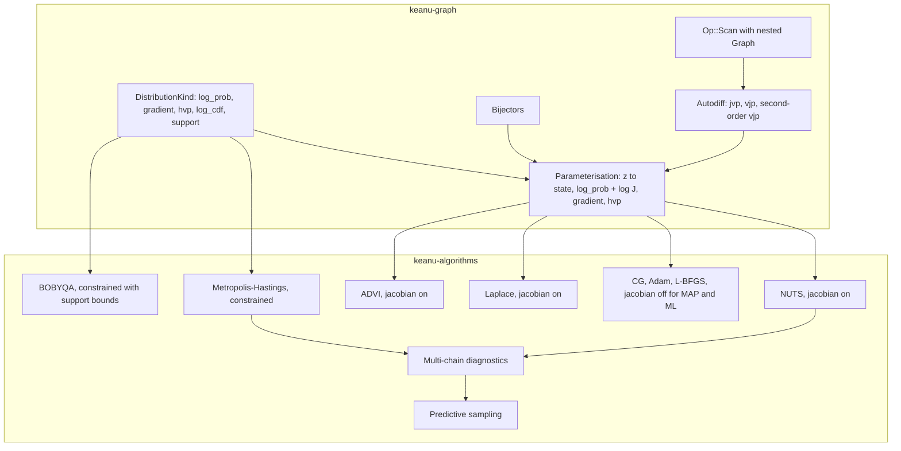
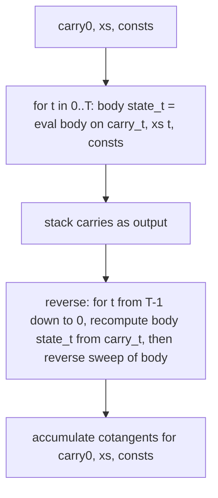
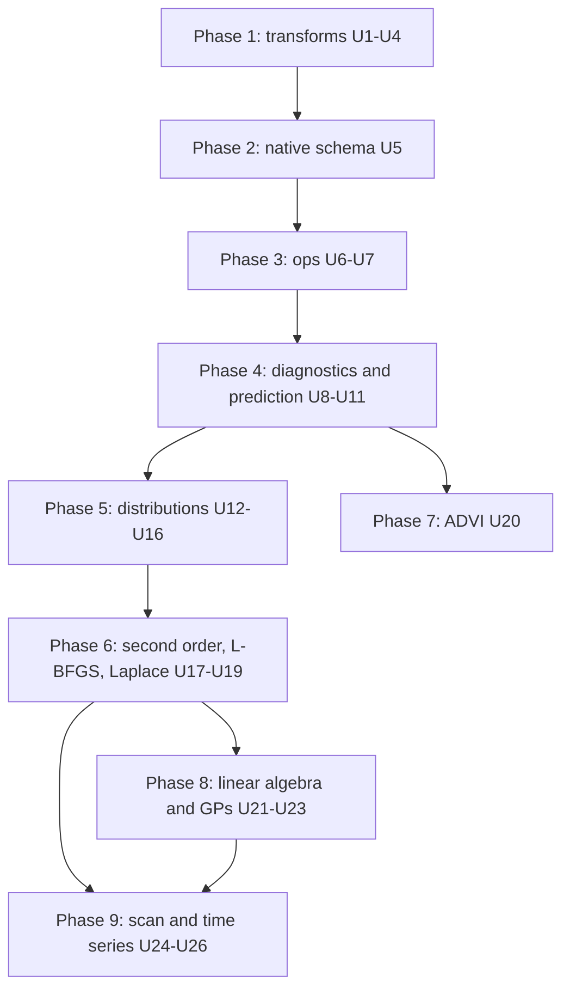

# Keanu PPL Feature Gaps - Plan

## Goal Capsule

- **Objective:** close the highest-value gaps between Keanu and PyMC / TensorFlow Probability: automatic constraint transforms, indexing and logsumexp, multi-chain diagnostics, a wider distribution library, exact Hessians with L-BFGS and Laplace, ADVI, exact Gaussian processes, a general scan with HMM and Kalman-filter distributions, and a native save schema, each with worked examples.
- **Authority:** this plan's Product Contract, then its Key Technical Decisions, then repo conventions (`CONTRIBUTING.md`, `docs/decisions/`). Java compatibility is not a constraint: golden Java results and the Java-compatible save format may change.
- **Execution profile:** phased; each phase leaves `main` green and releasable. Work on `main` of the fork, run the full Verification Contract before every commit, never `cargo publish`.
- **Stop conditions:** stop and ask if a unit needs a new non-MIT-compatible dependency, if an exact second-derivative rule cannot be written for an existing distribution, or if the scan design requires random variables inside the body.
- **Tail ownership:** each unit updates its book chapter and `CHANGELOG.md`; the implementer owns re-baselining any test whose expected values move because of transforms.

---

## Product Contract

### Summary

Add the missing building blocks that modern probabilistic programming relies on, in the order of the gap analysis.
NUTS and gradient optimizers move to unconstrained space by default through a bijector library.
New graph ops (gather, scatter-add, stack, logsumexp, a nested-graph scan), new tensor maths (special functions, solve, slogdet, eigh) and an exact Hessian-vector product unlock new distributions and algorithms.
New algorithms are L-BFGS, the Laplace approximation, ADVI and posterior-predictive sampling, plus rank-normalised R-hat and ESS.
The save format becomes Keanu-native.
Examples demonstrate each phase.

### Problem Frame

Keanu's core (graph, autodiff, NUTS, MH, MAP) is solid, but users cannot write the standard models of the field.
Hierarchical models need `mu[group]` indexing; mixtures and HMMs need logsumexp.
NUTS samples constrained parameters directly, so scale and simplex parameters diverge at the boundary (the `custom_distribution` example reparameterises by hand to survive).
There is no way to tell whether chains converged, no posterior predictive, no approximate inference, no GPs, and time series must be unrolled into O(T) graph nodes.

### Requirements

**Constraint transforms**
- R1. Every built-in continuous distribution declares its support (real, positive, interval, simplex, ordered, correlation-Cholesky).
- R2. NUTS and the gradient optimizers operate in unconstrained space by default, with an opt-out.
- R3. NUTS, ADVI and Laplace include the log-Jacobian term; MAP and maximum-likelihood optimise without it, so interior optima match the constrained optima and a mode on a support boundary is reported as such.

**Ops**
- R4. Graphs can index a tensor by an integer tensor node (gather) and accumulate by index (scatter-add), and can stack tensors.
- R5. Graphs have logsumexp, softmax and log-softmax with gradients.
- R6. Graphs have a deterministic general scan whose body is a nested graph, with forward, reverse and second-order autodiff.

**Diagnostics and prediction**
- R7. Multi-chain sample sets report rank-normalised split R-hat, bulk and tail ESS, and MCSE per element, plus a summary table.
- R8. NUTS reports per-draw energy, divergence flags and a divergence count.
- R9. Posterior-predictive and prior-predictive draws are available for observed nodes.

**Distributions**
- R10. New special functions: erf, erfc, erfinv, normal CDF and its log and inverse, log1mexp, softplus, logit, log-beta, regularised incomplete gamma and beta, log-scaled Bessel I0 and I1.
- R11. Continuous and count distributions expose log-CDF and log-survival functions where a closed form or special function exists.
- R12. New distributions: NegativeBinomial, Weibull, VonMises, OrderedLogistic, LKJCholesky, Mixture (same-family), Truncated and Censored wrappers.

**Optimisation and approximate inference**
- R13. Autodiff computes exact Hessian-vector products of the joint log probability with respect to continuous latents.
- R14. L-BFGS with a strong-Wolfe line search is available for MAP and ML.
- R15. A Laplace approximation returns the mode, covariance and draws mapped back to constrained space.
- R16. ADVI, mean-field and full-rank, returns a fitted approximation and posterior draws.

**Linear algebra and GPs**
- R17. Tensors and graph ops include general solve, slogdet and symmetric eigendecomposition with gradients.
- R18. A GP module provides covariance kernels, an exact GP marginal-likelihood distribution and the conditional predictive distribution.

**Time series**
- R19. HiddenMarkovModel and LinearGaussianStateSpace distributions compute exact marginal likelihoods.

**Persistence and examples**
- R20. A Keanu-native save schema (protobuf and JSON) covers every op and distribution, including nested scan graphs; Java class names are dropped.
- R21. New examples, each run as a test: eight schools, radon, Gaussian mixture, GP regression, stochastic volatility, HMM.

### Acceptance Examples

- AE1. Given a model with `sigma ~ HalfGaussian` and default NUTS, when sampled, no proposal is rejected for leaving the support and draws of `sigma` are all positive.
- AE2. Given `sigma ~ Gamma(theta = 0.5, k = 2)` alone, when MAP is run with transforms on, the result is the Gamma mode (k−1)θ = 0.5, not the mode of the transformed density.
- AE5. Given `sigma ~ HalfGaussian(1)` with no data, when MAP is run, the optimizer stops with a "mode on support boundary" result naming `sigma` instead of running to its iteration cap.
- AE3. Given eight schools in non-centred form with 4 chains, when sampled with NUTS, every R-hat is below 1.01 and there are no divergences; in centred form, divergences are reported.
- AE4. Given a GP regression model, when the predictive is evaluated at the training inputs with zero noise, it returns the training targets.

### Scope Boundaries

- GPU, SIMD and vectorised chains are out.
- Normalising flows, sparse or variational GPs, HSGP, BART and ABC are out.
- Random variables inside a scan body are out; per-step noise enters as a vector input.
- Lambda and `CustomDistribution` nodes stay unsaveable.
- Publishing to crates.io is out.

#### Deferred to Follow-Up Work

- Dense mass-matrix adaptation for NUTS.
- Zero-inflated and hurdle distributions.
- Model comparison (LOO, WAIC).
- Forward-filtering backward-sampling and Viterbi for HMMs.
- Checkpointing for long scans.

---

## Planning Contract

### Key Technical Decisions

- KTD1. **Supports live on `DistributionKind`, bijectors live in `keanu-graph`.** Each distribution kind returns a `Support` value; a `Bijector` maps unconstrained flat vectors to constrained tensors with `forward`, `inverse`, `log_det_jacobian` and the Jacobian-vector and vector-Jacobian products needed by the gradient and HVP. Transforms follow Stan's reference manual: lower bound `a + exp(y)`, interval `a + (b−a)·logistic(y)`, ordered via cumulative exp, simplex via the inverse isometric log-ratio then softmax (Stan ≥ 2.37), correlation Cholesky via tanh canonical partial correlations. Truncated distributions report an interval support.
- KTD2. **One `Parameterisation` seam serves every gradient algorithm.** It owns the list of continuous latents, their bijectors and the flat unconstrained layout, and exposes `log_prob_and_gradient(z, jacobian: bool)`, `hvp(z, v, jacobian)`, `to_state(z)` and `from_state`. NUTS, `Objective`, Laplace and ADVI consume it instead of reading latents directly. This replaces the ad hoc flatten / unflatten in `keanu-algorithms/src/optimizer/mod.rs` and `f64_values` in `keanu-algorithms/src/support.rs`.
- KTD3. **MAP without the Jacobian, sampling and VI with it.** This matches Stan and keeps interior MAP optima identical to the constrained optima, so optimizer golden values stay valid. When the constrained mode is on a boundary the unconstrained optimum is at infinity; the optimizer stops once a coordinate passes |z| > 30 and reports a boundary result naming the node.
- KTD4. **Metropolis–Hastings and BOBYQA stay in constrained space.** MH proposals are user-specified on constrained values; BOBYQA derives default bounds from scalar supports and intersects them with user bounds.
- KTD5. **Exact HVP is forward-over-reverse with hand-written second-order rules.** The reverse sweep gains a tangent channel: each op supplies the directional derivative of its VJP, and each distribution supplies a Hessian-vector product of its log density in value and parameters. A distribution or op without a rule returns a clear "no second-order rule" error rather than an approximation. Rejected: a generic dual-number autodiff (requires rewriting every tensor op over a scalar trait) and a symbolic gradient graph à la PyTensor (requires rewriting every distribution's log density as graph ops). TFP and PyMC compute Hessians exactly; Stan's Laplace uses finite differences, which this plan avoids.
- KTD6. **The general scan is a new op holding a nested `Graph`.** Rename the existing cumulative op from `Op::Scan` to `Op::Cumulative` and use `Op::Scan(Arc<ScanBody>)` for the general loop. A `ScanBody` is a `Graph` with one carry placeholder, per-step-input and constant placeholders, and one carry output; a scan has exactly one carry tensor and outputs it stacked as [T, carry...], and models with several carries pack them with Stack and Slice. Builds reject bodies containing distribution nodes. Evaluation runs the body T times on its own `State`. Reverse and second-order rules recompute each step's body state inside the Scan rule from the stacked output (carry_t), xs_t and the constants, so `State` and the VJP signature stay unchanged; cost is one extra body evaluation per step and memory stays O(T) through the stacked output. Unrolled sequences and the particle filter are unchanged.
- KTD7. **HMM and Kalman filter are dedicated distributions, not scan compositions.** Dedicated log-densities give closed-form gradients and second-order rules; the HMM uses the log-space forward algorithm and the Kalman filter uses Cholesky solves with the Joseph-form covariance update, as in TFP.
- KTD8. **Native save schema.** Replace `keanu-io/proto/io/improbable/mir/*.proto` and the Java class-name tables with a versioned Keanu schema whose ops are typed messages (one per op family, distribution kind by enum), plus nested subgraphs for scan. The Java loader and fixtures are removed; `book/src/from-java.md` keeps the API migration guide only.
- KTD9. **Special functions are written in-house from published algorithms.** No new dependency, consistent with Keanu's own samplers and MSRV 1.85; references include Giles (2010) for erfinv, Lentz continued fractions for incomplete beta, series and continued fraction for incomplete gamma. Reference values are generated offline at high precision and committed as fixtures. Numerical Recipes code is not copied.
- KTD10. **Diagnostics follow Vehtari et al. (2021) as implemented in ArviZ.** A new multi-chain sample type stacks per-chain `NetworkSamples`; R-hat is the max of bulk and folded rank-normalised split R-hat; ESS uses Geyer's initial monotone sequence on pooled autocovariances.
- KTD11. **L-BFGS mirrors Stan's settings.** History 5, strong Wolfe with c1 = 1e-4 and c2 = 0.9 using bracketing and zoom with cubic interpolation, pairs kept only when yᵀs > 0, convergence on gradient norm, relative objective and parameter change. It becomes the default gradient optimizer.
- KTD12. **ADVI follows Kucukelbir et al. (2017) and Stan's defaults.** Reparameterised Monte Carlo ELBO gradients in unconstrained space with the Jacobian, Stan's adaptive step-size sequence and η grid search, and relative-ELBO-change convergence over a ring buffer.
- KTD13. **Golden Java parity is retired for stochastic algorithms only.** Deterministic fixtures (tensors, distribution log densities, gradients, optimizer optima) stay as regression tests. Sampler and example tests that move under transforms switch to statistical checks against analytic posteriors or re-baselined values.

### High-Level Technical Design

The `Parameterisation` seam and how algorithms reach the graph:

Second-order reverse sweep (directional guidance): given latents z and direction v, a forward sweep pushes tangents of v through deterministic nodes; the reverse sweep carries pairs (cotangent, tangent-of-cotangent) and each op returns both its ordinary VJP and the VJP's derivative along the forward tangents. Distribution nodes seed both channels from their gradient and their Hessian-vector product. The bijector's own second derivative and log-Jacobian Hessian are applied at the boundary in `Parameterisation`.

Scan evaluation and reverse mode:

### Phase Map

Phase 7 needs Phases 1 and 4 (its eight-schools comparison uses U11). Phases 8 and 9 need Phase 6, and U25 also needs U21; U24 can run in parallel with Phase 8. Phase 2 precedes the op units so no new op ever gets a Java-format schema entry.

### Assumptions

- The `faer` 0.24 dependency provides the self-adjoint eigendecomposition needed by U21; solve and slogdet reuse the in-house `Lu` in `keanu-tensor/src/ops/linalg.rs`.
- Existing users accept the API break of renaming the cumulative op and the save format change; nothing is published yet.

---

## Implementation Units

### Unit Index

| U-ID | Title | Key files | Depends on |
|---|---|---|---|
| U1 | Distribution supports | `keanu-graph/src/op/distribution.rs` | none |
| U2 | Bijector library | `keanu-graph/src/transform.rs` | U1 |
| U3 | Parameterisation seam | `keanu-graph/src/parameterisation.rs`, `keanu-graph/src/model.rs` | U2 |
| U4 | Algorithms in unconstrained space | `keanu-algorithms/src/mcmc/nuts.rs`, `keanu-algorithms/src/optimizer/mod.rs` | U3 |
| U5 | Native save schema | `keanu-io/proto/`, `keanu-io/src/save.rs`, `keanu-io/src/load.rs` | U1 |
| U6 | Gather, scatter-add, stack | `keanu-graph/src/op/mod.rs`, `keanu-graph/src/autodiff.rs` | U5 |
| U7 | logsumexp and softmax | `keanu-tensor/src/ops/reduce.rs`, `keanu-graph/src/autodiff.rs` | U5 |
| U8 | Multi-chain diagnostics | `keanu-algorithms/src/diagnostics.rs` | none |
| U9 | NUTS energy and divergences | `keanu-algorithms/src/mcmc/nuts.rs` | U4 |
| U10 | Predictive sampling | `keanu-algorithms/src/predictive.rs` | none |
| U11 | Eight schools and radon examples | `keanu/examples/eight_schools.rs`, `keanu/examples/radon.rs` | U4, U6, U8, U9 |
| U12 | Special functions | `keanu-tensor/src/special.rs` | none |
| U13 | CDFs, Truncated, Censored | `keanu-distributions/src/`, `keanu-graph/src/op/distribution.rs` | U2, U12 |
| U14 | New univariate distributions | `keanu-distributions/src/continuous.rs`, `keanu-distributions/src/discrete.rs` | U1, U12 |
| U15 | Mixture and mixture example | `keanu-distributions/src/mixture.rs`, `keanu/examples/gaussian_mixture.rs` | U7, U14 |
| U16 | LKJCholesky | `keanu-distributions/src/multivariate.rs` | U2 |
| U17 | Exact Hessian-vector products | `keanu-graph/src/autodiff.rs`, `keanu-graph/src/parameterisation.rs` | U3, U13-U16 |
| U18 | L-BFGS | `keanu-algorithms/src/optimizer/lbfgs.rs` | U4 |
| U19 | Laplace approximation | `keanu-algorithms/src/laplace.rs` | U17, U18 |
| U20 | ADVI | `keanu-algorithms/src/vi/` | U4, U11 |
| U21 | Triangular solve op, solve, slogdet, eigh | `keanu-tensor/src/ops/linalg.rs`, `keanu-graph/src/autodiff.rs` | U17 |
| U22 | Gaussian processes | `keanu-graph/src/gp.rs` | U21 |
| U23 | GP regression example | `keanu/examples/gp_regression.rs` | U22 |
| U24 | Nested graphs and scan | `keanu-graph/src/graph.rs`, `keanu-graph/src/op/scan.rs` | U17, U5 |
| U25 | HMM and Kalman distributions | `keanu-distributions/src/timeseries.rs` | U7, U17, U21 |
| U26 | Stochastic volatility and HMM examples | `keanu/examples/stochastic_volatility.rs`, `keanu/examples/hmm.rs` | U24, U25 |

### Phase 1: constraint transforms

### U1. Distribution supports

- **Goal:** every built-in distribution reports its support.
- **Requirements:** R1.
- **Dependencies:** none.
- **Files:** `keanu-graph/src/op/distribution.rs`, `keanu-graph/src/lib.rs`, `keanu-graph/tests/support.rs`.
- **Approach:** add a `Support` enum (Real, GreaterThan(f64 or parameter), Interval(lower, upper), Simplex, Ordered, CorrelationCholesky, Discrete) and a `support(params)` method generated through the `distributions!` macro table with a per-row `support=` entry. Parameter-dependent bounds (Uniform, Pareto, Triangular) resolve from parameter values at the current state. `CustomDistribution` gains an optional `support` method defaulting to Real.
- **Patterns to follow:** the `sample=` / `gradient=` overrides in the `distributions!` macro.
- **Test scenarios:**
  - Each continuous built-in reports the support stated in its doc comment (table-driven over all kinds).
  - Uniform(2, 5) reports Interval(2, 5); after its parameters change in the state, the support follows.
  - Dirichlet reports Simplex; discrete kinds report Discrete.
  - A custom distribution without a `support` method reports Real.
- **Verification:** support of every kind is covered by the table test.

### U2. Bijector library

- **Goal:** bijectors for every support in U1.
- **Requirements:** R1, R2.
- **Dependencies:** U1.
- **Files:** `keanu-graph/src/transform.rs`, `keanu-graph/tests/transform.rs`.
- **Approach:** one `Bijector` per support (Identity, LowerBound, Interval, Ordered, Simplex via inverse ILR and softmax, CorrelationCholesky via tanh partial correlations). Each provides forward, inverse, log|J|, the Jacobian-vector product of forward, and the gradient of log|J|; second-order pieces arrive in U17. Unconstrained sizes can differ from constrained sizes (simplex K → K−1, correlation Cholesky K×K → K(K−1)/2). Formulas per KTD1.
- **Test scenarios:**
  - Round trip: inverse(forward(y)) ≈ y for random y, and forward(inverse(x)) ≈ x for valid x, for every bijector and shapes 1, 3, 2×3.
  - log|J| matches a finite-difference log-determinant of the forward Jacobian.
  - Gradient of log|J| matches finite differences.
  - Simplex output sums to 1 and is positive for extreme y (±50); correlation Cholesky output has unit-norm rows and a positive diagonal.
  - Interval with lower = upper, or a lower bound of NaN, is rejected with an error.
  - Inverse of a value on the boundary (exactly 0 for LowerBound(0)) returns an error, not NaN.
- **Verification:** all bijectors pass round-trip and Jacobian checks.

### U3. Parameterisation seam

- **Goal:** one object that maps a flat unconstrained vector to a model state and back, and evaluates log probability and gradient with or without the Jacobian.
- **Requirements:** R2, R3.
- **Dependencies:** U2.
- **Files:** `keanu-graph/src/parameterisation.rs`, `keanu-graph/src/model.rs`, `keanu-graph/src/lib.rs`, `keanu-graph/tests/parameterisation.rs`.
- **Approach:** built from a `Model` and `State`; selects continuous latents, resolves bijectors from supports at construction (parameter-dependent bounds are fixed at the parameter values in the state; a bound that depends on another latent is rejected with an error suggesting a reparameterisation). Exposes `dimension`, `to_state`, `from_state`, `log_prob_and_gradient(z, jacobian)` using the existing `Model::log_prob_and_gradient` plus the chain rule through the bijector, and an `Unconstrained` / `Constrained` option where Constrained uses Identity everywhere. An opt-in initialisation helper draws z from Uniform(−2, 2) like Stan; by default every algorithm starts from the supplied state. A value outside or on the boundary of its support makes `from_state` fail with an error that the algorithms report as `AlgorithmError::ImpossibleStart`.
- **Patterns to follow:** `Objective` in `keanu-algorithms/src/optimizer/mod.rs` for flat layout; `Model::log_prob_and_gradient` in `keanu-graph/src/model.rs`.
- **Test scenarios:**
  - With jacobian = false, log prob at z equals the model's constrained log prob at forward(z).
  - With jacobian = true, it adds Σ log|J|; checked on Gamma, Beta and Dirichlet latents.
  - Gradient matches finite differences in z for a model mixing Gaussian, HalfGaussian, Beta and Dirichlet latents.
  - `from_state` then `to_state` leaves the state unchanged.
  - Constrained mode reproduces current behaviour exactly.
  - A Uniform whose bound is another latent errors at construction with a reparameterisation hint.
  - A model with no continuous latents has dimension 0 and log prob equal to the model's.
- **Verification:** NUTS-free unit tests pass; existing model tests unchanged.

### U4. Algorithms in unconstrained space

- **Goal:** NUTS and gradient optimizers use the parameterisation, unconstrained by default; MH and BOBYQA stay constrained.
- **Requirements:** R2, R3.
- **Dependencies:** U3.
- **Files:** `keanu-algorithms/src/mcmc/nuts.rs`, `keanu-algorithms/src/optimizer/mod.rs`, `keanu-algorithms/src/optimizer/adam.rs`, `keanu-algorithms/src/optimizer/conjugate_gradient.rs`, `keanu-algorithms/src/optimizer/bobyqa/mod.rs`, `keanu-algorithms/src/support.rs`, `keanu-algorithms/tests/mcmc.rs`, `keanu-algorithms/tests/optimizers.rs`, `keanu-algorithms/tests/golden_samplers.rs`, `keanu/tests/examples.rs`, `book/src/inference-sampling.md`, `book/src/inference-map.md`.
- **Approach:** NUTS positions, mass-matrix adaptation and leapfrog run in z with jacobian = true; samples are recorded in constrained space. `Objective` wraps the parameterisation with jacobian = false. `Objective` takes a jacobian flag, false for MAP and ML. A `space(Space::Constrained)` builder option on `Nuts` and `GradientOptimizer` opts out. The boundary stop from KTD3 lives in `Objective`. BOBYQA gets default bounds from scalar supports. Re-baseline per KTD13; the golden Adam parity cases run with `Space::Constrained` because they are an exact port of Java's trajectory.
- **Execution note:** run the full sampler and example test suites before changing anything to record which assertions move, then re-baseline only those.
- **Test scenarios:**
  - Covers AE1. NUTS on `sigma ~ HalfGaussian(1)` observed through `y ~ Gaussian(0, sigma)` produces only positive draws and matches the analytic posterior moments.
  - NUTS on a Beta-Binomial conjugate model matches the Beta posterior mean and variance within Monte Carlo error.
  - NUTS on a Dirichlet-Multinomial model matches the Dirichlet posterior means.
  - Covers AE2. MAP on Gamma(theta = 0.5, k = 2) returns 0.5 with CG and Adam.
  - Covers AE5. MAP on HalfGaussian(1) with no data returns the boundary result for `sigma`.
  - Optimizer golden optima from Java still pass (Adam cases in constrained space; unconstrained Adam checked against the optimum at the CG tolerance).
  - Existing impossible-start tests (Uniform(0, 1) set to 5.0, Uniform(0, 2) set to 0.0) still return `ImpossibleStart`.
  - `Space::Constrained` reproduces pre-change NUTS draws for a fixed seed.
  - BOBYQA on a HalfGaussian latent never evaluates a negative value.
  - The `custom_distribution` example still converges.
- **Verification:** all tests pass with re-baselined values recorded in `CHANGELOG.md`.

### Phase 2: native save schema

### U5. Native save schema

- **Goal:** replace the Java-compatible schema with a versioned Keanu schema covering every current op and distribution.
- **Requirements:** R20.
- **Dependencies:** U1.
- **Files:** `keanu-io/proto/keanu/graph.proto` (new), `keanu-io/proto/io/improbable/mir/` (remove), `keanu-io/Cargo.toml` (drop the `golden_models` test target), `keanu-parity/fixtures/golden-vectors/models/` (convert), `keanu-algorithms/tests/golden_optimizers.rs`, `keanu-algorithms/tests/golden_samplers.rs`, `keanu-algorithms/tests/golden_bobyqa.rs`, `keanu/benches/models.rs`, `keanu-io/src/generated/`, `keanu-io/src/classes.rs` (remove or reduce), `keanu-io/src/save.rs`, `keanu-io/src/load.rs`, `keanu-io/src/dot.rs`, `keanu-io/tests/generated_code.rs`, `keanu-io/tests/round_trip.rs`, `keanu-io/tests/golden_models.rs` (remove), `keanu-io/tests/fixtures/`, `book/src/save-and-load.md`, `book/src/from-java.md`.
- **Execution note:** while the Java loader still exists, convert every golden model under `keanu-parity/fixtures/golden-vectors/models/` to the native schema and commit the results; then switch the golden tests and benchmarks to the native loader; only then delete the Java loader.
- **Approach:** per KTD8. Schema has a format version, typed node messages per op family, distribution kind as an enum with parameter list, observed values, labels and reserved space for subgraphs. Every later unit that adds an op or distribution adds its schema entry and round-trip case. Regenerate code through the existing `KEANU_REGENERATE=1` test.
- **Test scenarios:**
  - Every op variant and distribution kind round-trips through protobuf and JSON (table-driven, replacing `every_simple_op_round_trips`).
  - Observed values, labels and state values survive a round trip.
  - Loading a file with an unknown future version returns a version error.
  - Lambda and custom distribution nodes return the existing unsupported error.
  - The generated-code staleness test passes.
  - Every converted golden model loads and gives the same log probability as before conversion; the golden optimizer, sampler and BOBYQA tests pass on the converted files.
- **Verification:** round-trip suite covers the whole `Op` enum.

### Phase 3: ops

### U6. Gather, scatter-add, stack

- **Goal:** index-by-tensor ops for hierarchical models.
- **Requirements:** R4.
- **Dependencies:** U5.
- **Files:** `keanu-tensor/src/ops/shape_ops.rs`, `keanu-graph/src/op/mod.rs`, `keanu-graph/src/op/shape.rs`, `keanu-graph/src/op/eval.rs`, `keanu-graph/src/autodiff.rs`, `keanu-graph/src/vars.rs`, `keanu-io/src/save.rs`, `keanu-io/src/load.rs`, `keanu-graph/tests/indexing.rs`, `book/src/building-models.md`.
- **Approach:** `Gather { axis }` takes a value parent and an `IntVar` index parent; `ScatterAdd { axis, size }` is its adjoint; `Stack { axis }` takes n parents. Gather's reverse rule is scatter-add and vice versa. Indices are non-differentiable. Out-of-range indices are an evaluation error.
- **Patterns to follow:** reuse the `gather_forward` / `gather_reverse` kernels in `keanu-graph/src/autodiff.rs`, but build the (parent, index) map from the current index value on every jvp and vjp call. Do not use the `Graph::index_map` cache, which assumes the map depends only on shapes and would freeze the first index values.
- **Test scenarios:**
  - `mu.gather(group_idx)` with mu shape [3] and index [0, 2, 2, 1] yields the expected values.
  - Gather on axis 1 of a [2, 3] tensor with index shape [4] yields shape [2, 4].
  - Repeated indices accumulate gradients (forward and reverse match finite differences).
  - Index −1 or ≥ length returns an error, not a panic.
  - A changing index node (a categorical latent) propagates through cascade.
  - Stack of three [2] tensors on axis 0 gives [3, 2]; gradients split correctly.
  - Empty index tensor yields an empty result.
- **Verification:** autodiff tests pass; no_panic proptest covers the new ops.

### U7. logsumexp and softmax

- **Goal:** stable logsumexp, softmax and log-softmax.
- **Requirements:** R5.
- **Dependencies:** U5.
- **Files:** `keanu-tensor/src/ops/reduce.rs`, `keanu-graph/src/op/mod.rs`, `keanu-graph/src/autodiff.rs`, `keanu-graph/src/vars.rs`, `keanu-io/src/save.rs`, `keanu-graph/tests/autodiff.rs`, `keanu-tensor/tests/properties.rs`.
- **Approach:** `ReduceOp::LogSumExp` with max-shift; `Softmax { axis }` and `LogSoftmax { axis }` as ops. Gradient of logsumexp is softmax.
- **Test scenarios:**
  - logsumexp([1000, 1000]) = 1000 + ln 2 without overflow.
  - logsumexp of all −∞ is −∞ and its gradient is not NaN.
  - Softmax sums to 1 along the axis; log-softmax equals log of softmax.
  - Gradients match finite differences on random inputs over several axes.
- **Verification:** property and autodiff tests pass.

### Phase 4: diagnostics and prediction

### U8. Multi-chain diagnostics

- **Goal:** multi-chain sample sets with R-hat, bulk and tail ESS, MCSE and a summary table.
- **Requirements:** R7.
- **Dependencies:** none.
- **Files:** `keanu-algorithms/src/diagnostics.rs`, `keanu-algorithms/src/samples.rs`, `keanu-algorithms/src/mcmc/chains.rs`, `keanu-algorithms/src/lib.rs`, `keanu-algorithms/tests/diagnostics.rs`, `book/src/autocorrelation.md`.
- **Approach:** a `ChainSamples` type built from `Vec<NetworkSamples>` with matching nodes and equal lengths (error otherwise); `run_chains` gains a convenience that returns it. Diagnostics per KTD10, reusing the FFT autocovariance in `keanu-algorithms/src/statistics.rs`. `summary()` returns per-element mean, sd, 5/50/95% quantiles, MCSE, bulk ESS, tail ESS and R-hat.
- **Test scenarios:**
  - Four chains of iid N(0,1): R-hat within 1.01 and bulk ESS near the draw count.
  - Four chains where one is shifted by 3: R-hat > 1.1.
  - Chains with equal means but one with 3× variance: folded R-hat flags it.
  - AR(1) with ρ = 0.9: bulk ESS within 15% of the analytic n(1−ρ)/(1+ρ).
  - Values match ArviZ reference outputs on a committed fixture (generated offline).
  - Constant chains give R-hat NaN-free handling (documented value) and no panic.
  - Mismatched chain lengths or node sets return an error.
- **Verification:** diagnostics match the ArviZ fixture to 1e-6.

### U9. NUTS energy and divergences

- **Goal:** surface per-draw energy, divergence flags and a count.
- **Requirements:** R8.
- **Dependencies:** U4.
- **Files:** `keanu-algorithms/src/mcmc/nuts.rs`, `keanu-algorithms/tests/mcmc.rs`, `book/src/inference-sampling.md`.
- **Approach:** add an `energy` series to `NutsStatistics` and an E-BFMI helper; derive `divergence_count()` and a per-draw divergence view from the existing `divergent_steps` field. Detection already exists at `max_energy_change`.
- **Test scenarios:**
  - Covers AE3. Centred eight schools reports at least one divergence with a fixed seed; non-centred reports none.
  - Energy series length equals the number of draws.
  - E-BFMI on a standard Gaussian target is above 0.3.
- **Verification:** statistics tests pass.

### U10. Predictive sampling

- **Goal:** prior- and posterior-predictive draws for observed nodes.
- **Requirements:** R9.
- **Dependencies:** none.
- **Files:** `keanu-algorithms/src/predictive.rs`, `keanu-algorithms/src/forward.rs`, `keanu-algorithms/src/lib.rs`, `keanu-algorithms/tests/predictive.rs`, `book/src/inference-sampling.md`.
- **Approach:** for each posterior draw, set latents, unobserve the requested nodes in a cloned state, cascade deterministic nodes and sample the targets; prior predictive uses the forward sampler with targets unobserved. Optional thinning to a requested number of draws.
- **Test scenarios:**
  - Posterior predictive of a Gaussian with known variance and conjugate mean matches the analytic predictive mean and variance.
  - Prior predictive of `y ~ Poisson(lambda)`, `lambda ~ Gamma` matches the negative binomial moments.
  - Requesting a non-observed or unknown node returns an error.
  - The input state's observed values are unchanged afterwards.
- **Verification:** tests pass.

### U11. Eight schools and radon examples

- **Goal:** canonical hierarchical examples using transforms, gather and diagnostics.
- **Requirements:** R21.
- **Dependencies:** U4, U6, U8, U9.
- **Files:** `keanu/examples/eight_schools.rs`, `keanu/examples/radon.rs`, `keanu/examples/data/radon.csv`, `keanu/tests/examples.rs`, `book/src/examples.md`.
- **Approach:** eight schools in centred and non-centred forms, reporting divergences and R-hat; radon varying-intercept model using gather over county index. Follow the `run(seed, samples)` pattern with an `#[allow(dead_code)] fn main`.
- **Test scenarios:**
  - Covers AE3. Non-centred eight schools: all R-hat < 1.01, no divergences, posterior mean of mu within 1 of the published value (≈ 4.4).
  - Radon: county intercept posterior means correlate with published values (Gelman & Hill) and R-hat < 1.01.
- **Verification:** both examples run as tests within the existing test time budget.

### Phase 5: distributions

### U12. Special functions

- **Goal:** special functions needed by CDFs and new distributions.
- **Requirements:** R10.
- **Dependencies:** none.
- **Files:** `keanu-tensor/src/special.rs` (extend), `keanu-tensor/tests/special.rs`, `keanu-tensor/tests/fixtures/special.json`, `keanu-graph/src/op/mod.rs`, `keanu-graph/src/autodiff.rs`, `keanu-io/proto/keanu/graph.proto`, `keanu-io/src/save.rs`, `keanu-io/src/load.rs`.
- **Approach:** per KTD9. Expose erf, erfc, erfinv, log_ndtr, ndtri, softplus, logit, log1mexp and LogBeta as `UnaryOp` / `BinaryOp` variants with derivatives; incomplete gamma and beta and Bessel functions are tensor-level only, used inside distributions. Also provide the first derivatives of the regularised incomplete gamma with respect to a and of the regularised incomplete beta with respect to a and b, following Stan's published series (`grad_reg_inc_gamma`, `inc_beta_dda` / `inc_beta_ddb`), so CDF shape-parameter gradients in U13 are exact.
- **Test scenarios:**
  - Each function matches the high-precision fixture to 1e-12 relative on its normal range and 1e-9 in the tails.
  - log_ndtr(−40) is finite and accurate; ndtri(0) = −∞ and ndtri(1) = +∞.
  - Incomplete gamma and beta are monotone in x and hit 0 and 1 at the bounds.
  - Graph op derivatives match finite differences.
  - Incomplete gamma and beta shape derivatives match the fixture to 1e-9.
  - Each new unary and binary op round-trips through save and load.
- **Verification:** fixture test passes.

### U13. CDFs, Truncated and Censored

- **Goal:** log-CDF and log-survival for distributions, and the Truncated and Censored wrappers.
- **Requirements:** R11, R12.
- **Dependencies:** U2, U12.
- **Files:** `keanu-distributions/src/continuous.rs`, `keanu-distributions/src/discrete.rs`, `keanu-distributions/src/wrappers.rs`, `keanu-graph/src/op/distribution.rs`, `keanu-graph/src/distributions.rs`, `keanu-io/src/save.rs`, `keanu-distributions/tests/cdf.rs`, `keanu-graph/tests/wrappers.rs`, `book/src/building-models.md`.
- **Approach:** add `log_cdf` and `log_ccdf` (with parameter gradients) to Gaussian, LogNormal, Exponential, Gamma, Beta, StudentT, Cauchy, Laplace, Logistic, Uniform, Poisson and Binomial (Weibull and NegativeBinomial get theirs in U14). Truncated(base, lower, upper) renormalises by the CDF difference, reports an interval support and samples by inverse CDF where available and rejection otherwise. Censored(base, lower, upper) adds log_cdf at the lower bound and log_ccdf at the upper bound. The wrapper rows hold a base `DistributionKind` and its parameters.
- **Test scenarios:**
  - log_cdf matches numerical integration of the density for each distribution at several points.
  - log_cdf + log_ccdf combine to probability 1 (logaddexp ≈ 0).
  - Truncated Gaussian(0, 1, lower 0) density equals 2× the Gaussian density on x > 0 and −∞ below.
  - Truncated samples lie within bounds and match the truncated mean.
  - Censored likelihood at a value equal to the upper bound equals log_ccdf.
  - Gradients of the wrappers match finite differences.
  - Lower ≥ upper returns an error.
- **Verification:** tests pass; NUTS on a truncated latent stays inside the bounds.

### U14. New univariate distributions

- **Goal:** NegativeBinomial, Weibull, VonMises and OrderedLogistic.
- **Requirements:** R12.
- **Dependencies:** U1, U12.
- **Files:** `keanu-distributions/src/continuous.rs`, `keanu-distributions/src/discrete.rs`, `keanu-graph/src/op/distribution.rs`, `keanu-graph/src/distributions.rs`, `keanu-io/src/save.rs`, `keanu-io/src/dot.rs`, `keanu-distributions/tests/samplers.rs`, `keanu-distributions/tests/gradients.rs`.
- **Approach:** NegativeBinomial in mean-dispersion form (mu, alpha) as in PyMC; Weibull(alpha, beta); VonMises(mu, kappa) with log-scaled Bessel normalisation and Best–Fisher sampling, support Interval(−π, π); OrderedLogistic(eta, cutpoints) per Stan, computed in log space, cutpoints requiring the Ordered bijector when latent. Weibull and NegativeBinomial also provide `log_cdf` and `log_ccdf` with parameter gradients.
- **Patterns to follow:** existing distribution struct + gradient struct + macro row pattern; `assert_moments` and `assert_ks` in `keanu-distributions/tests/samplers.rs`.
- **Test scenarios:**
  - Each sampler passes the moment and KS tests.
  - Each log density matches a reference value computed offline.
  - Parameter gradients match finite differences.
  - NegativeBinomial with large alpha approaches Poisson.
  - VonMises with kappa = 0 is uniform on the circle; kappa = 500 is stable.
  - OrderedLogistic probabilities sum to 1; non-increasing cutpoints return an error.
  - Weibull and NegativeBinomial log_cdf match numerical integration or summation, and their gradients match finite differences.
- **Verification:** tests pass.

### U15. Mixture and mixture example

- **Goal:** same-family mixtures and a Gaussian mixture example.
- **Requirements:** R12, R21.
- **Dependencies:** U7, U14.
- **Files:** `keanu-distributions/src/mixture.rs`, `keanu-graph/src/op/distribution.rs`, `keanu-graph/src/distributions.rs`, `keanu-io/src/save.rs`, `keanu-graph/tests/mixture.rs`, `keanu/examples/gaussian_mixture.rs`, `keanu/tests/examples.rs`.
- **Approach:** Mixture(weights, component kind, component params with a trailing component axis); log density is logsumexp of log weights plus component log densities; gradients are responsibility-weighted component gradients. Support is the component support. Example fits a two-component Gaussian mixture with ordered means to break label switching.
- **Test scenarios:**
  - Mixture with a single component equals that component.
  - Mixture density integrates to 1 numerically.
  - Gradients match finite differences for weights and component parameters.
  - Samples match the mixture moments.
  - Example recovers component means within posterior uncertainty and R-hat < 1.01.
- **Verification:** tests and example pass.

### U16. LKJCholesky

- **Goal:** LKJ prior on Cholesky factors of correlation matrices.
- **Requirements:** R12.
- **Dependencies:** U2.
- **Files:** `keanu-distributions/src/multivariate.rs`, `keanu-graph/src/op/distribution.rs`, `keanu-graph/src/distributions.rs`, `keanu-io/src/save.rs`, `keanu-distributions/tests/samplers.rs`.
- **Approach:** density ∝ Π L_kk^(K−k+2η−2) per Stan, with the normalising constant from Lewandowski et al. (2009) so η can be latent; support CorrelationCholesky; sampling by the onion method.
- **Test scenarios:**
  - With η = 1 and K = 2, sampled correlations are uniform on (−1, 1).
  - Sampled factors have unit-norm rows.
  - Log density gradient in L and η matches finite differences.
  - NUTS on LKJCholesky(η = 2, K = 3) alone recovers the known marginal correlation variance.
- **Verification:** tests pass.

### Phase 6: second order, L-BFGS and Laplace

### U17. Exact Hessian-vector products

- **Goal:** exact HVP of the joint log probability with respect to continuous latents, in unconstrained space.
- **Requirements:** R13.
- **Dependencies:** U3, U13, U14, U15, U16.
- **Files:** `keanu-graph/src/autodiff.rs`, `keanu-graph/src/op/distribution.rs`, `keanu-distributions/src/*.rs`, `keanu-graph/src/transform.rs`, `keanu-graph/src/parameterisation.rs`, `keanu-graph/tests/hessian.rs`.
- **Approach:** per KTD5. Add a second-order reverse sweep alongside `reverse_sweep`, a per-op second-order rule next to each `vjp` arm, a per-distribution `log_prob_hvp`, and bijector second derivatives. `Parameterisation::hvp` and `hessian` (n HVPs) are the public entry points. Lambda ops and custom distributions error unless they supply a second-order closure.
- **Execution note:** write the finite-difference Hessian checker first and drive each op and distribution rule from it.
- **Test scenarios:**
  - For every op family and distribution kind, HVP matches finite differences of the gradient on random points (table-driven).
  - Hessian is symmetric to 1e-8 on a mixed model.
  - Hessian of a multivariate Gaussian log density equals −Σ⁻¹ exactly.
  - Bijector contributions: Hessian of log|J| for LowerBound equals 0 and for Interval matches finite differences.
  - A model containing a Lambda without a second-order rule returns the no-rule error naming the node.
- **Verification:** table-driven check covers the whole op enum and distribution table.

### U18. L-BFGS

- **Goal:** L-BFGS optimizer as the default for MAP and ML.
- **Requirements:** R14.
- **Dependencies:** U4.
- **Files:** `keanu-algorithms/src/optimizer/lbfgs.rs`, `keanu-algorithms/src/optimizer/line_search.rs`, `keanu-algorithms/src/optimizer/mod.rs`, `keanu-algorithms/tests/optimizers.rs`, `keanu/benches/models.rs`, `book/src/inference-map.md`.
- **Approach:** per KTD11, working on flat vectors like `ConjugateGradient` and accepting an `Objective` with either jacobian setting; new `Algorithm::Lbfgs` variant becomes `Default`. The strong-Wolfe line search lives in its own module so CG can adopt it later.
- **Test scenarios:**
  - Rosenbrock in 2 and 10 dimensions converges to (1, …, 1) within the iteration budget.
  - Java optimizer golden optima pass with L-BFGS.
  - A pair with yᵀs ≤ 0 is skipped without failure.
  - A non-finite objective at the start returns an error; a non-finite trial point shrinks the step.
  - Benchmarks show L-BFGS at or below CG's evaluation count on the golden models.
- **Verification:** tests pass; benchmark numbers added to `docs/benchmarks.md`.

### U19. Laplace approximation

- **Goal:** Gaussian approximation at the mode in unconstrained space.
- **Requirements:** R15.
- **Dependencies:** U17, U18.
- **Files:** `keanu-algorithms/src/laplace.rs`, `keanu-algorithms/src/lib.rs`, `keanu-algorithms/tests/laplace.rs`, `book/src/inference-map.md`.
- **Approach:** find the mode of the Jacobian-adjusted density with L-BFGS on an `Objective` built with jacobian = true, compute the exact Hessian, factor −H by Cholesky (error with guidance if not positive definite), draw z = ẑ + L⁻ᵀε and map to constrained space as `NetworkSamples`.
- **Test scenarios:**
  - On a Gaussian-Gaussian conjugate model, mean and covariance match the exact posterior.
  - On a Gamma latent, draws are positive and the mode is the Jacobian-adjusted mode.
  - A non-positive-definite Hessian (saddle) returns an error.
  - Draws are reproducible for a fixed seed.
- **Verification:** tests pass.

### Phase 7: variational inference

### U20. ADVI

- **Goal:** mean-field and full-rank ADVI.
- **Requirements:** R16.
- **Dependencies:** U4, U11.
- **Files:** `keanu-algorithms/src/vi/mod.rs`, `keanu-algorithms/src/vi/advi.rs`, `keanu-algorithms/tests/advi.rs`, `book/src/inference-vi.md` (new), `book/src/SUMMARY.md`.
- **Approach:** per KTD12 on the parameterisation with jacobian = true. Result exposes the approximation's mean and covariance in unconstrained space, the ELBO trace, and `sample(n)` returning constrained `NetworkSamples`.
- **Test scenarios:**
  - Mean-field on an independent Gaussian posterior recovers means and variances.
  - Full-rank on a correlated bivariate Gaussian recovers the correlation; mean-field underestimates marginal variance as expected.
  - On eight schools (non-centred), ADVI means are within 1 posterior sd of NUTS means.
  - ELBO increases on average over the run; convergence triggers before the iteration cap on easy models.
  - Results are reproducible for a fixed seed.
- **Verification:** tests pass.

### Phase 8: linear algebra and Gaussian processes

### U21. Triangular solve op, solve, slogdet, eigh

- **Goal:** linear algebra graph ops with gradients.
- **Requirements:** R17.
- **Dependencies:** U17.
- **Files:** `keanu-tensor/src/ops/linalg.rs`, `keanu-graph/src/op/mod.rs`, `keanu-graph/src/autodiff.rs`, `keanu-graph/src/vars.rs`, `keanu-io/src/save.rs`, `keanu-tensor/tests/linalg.rs`, `keanu-graph/tests/autodiff.rs`, `book/src/tensors.md`.
- **Approach:** batched over leading dimensions like the existing linalg. A `SolveTriangular { lower, transpose }` graph op wraps the existing tensor `solve_triangular` for GP and Kalman Cholesky solves. Solve and slogdet reuse the in-house `Lu` and its singular flag so singularity is defined once; eigh uses faer's self-adjoint decomposition. First- and second-order rules; eigh gradients assume distinct eigenvalues and document it.
- **Test scenarios:**
  - SolveTriangular matches the tensor function, and its gradients and HVPs match finite differences for both `lower` and `transpose` settings.
  - solve(A, b) satisfies A·x ≈ b for random well-conditioned A, batched.
  - Singular A returns an error.
  - slogdet matches ln|det| for positive and negative determinants.
  - eigh reconstructs A = QΛQᵀ; eigenvalues ascending.
  - Gradients and HVPs match finite differences.
- **Verification:** tests pass.

### U22. Gaussian processes

- **Goal:** kernels, exact GP marginal likelihood and predictive.
- **Requirements:** R18.
- **Dependencies:** U21.
- **Files:** `keanu-graph/src/gp.rs`, `keanu-graph/src/lib.rs`, `keanu-graph/tests/gp.rs`, `book/src/gaussian-processes.md` (new), `book/src/SUMMARY.md`.
- **Approach:** kernels as graph-building functions over `DoubleVar` inputs (ExpQuad, Matérn 1/2, 3/2, 5/2, RationalQuadratic, Periodic, Linear, sums and products), producing covariance nodes. `gp_marginal(x, y, mean, kernel, noise)` builds an observed MultivariateGaussian with jitter; `gp_predict(...)` builds the conditional mean and covariance via Cholesky and `SolveTriangular` nodes.
- **Test scenarios:**
  - Each kernel is symmetric and positive semi-definite on random inputs.
  - Marginal log likelihood matches a hand-computed value on a 3-point dataset.
  - Covers AE4. Predictive at training inputs with zero noise returns the training targets and zero variance (within jitter).
  - Kernel hyperparameter gradients match finite differences.
- **Verification:** tests pass.

### U23. GP regression example

- **Goal:** GP regression with hyperparameters sampled by NUTS.
- **Requirements:** R21.
- **Dependencies:** U22.
- **Files:** `keanu/examples/gp_regression.rs`, `keanu/tests/examples.rs`, `book/src/examples.md`.
- **Approach:** synthetic sine data with noise; ExpQuad kernel with HalfGaussian length-scale and amplitude priors; NUTS on hyperparameters, then posterior-predictive mean on a grid.
- **Test scenarios:**
  - Predictive mean is within 2 predictive sd of the true function on the grid.
  - R-hat < 1.01 for hyperparameters.
- **Verification:** example runs as a test.

### Phase 9: scan and time series

### U24. Nested graphs and scan

- **Goal:** a deterministic general scan op over a nested graph.
- **Requirements:** R6.
- **Dependencies:** U17, U5.
- **Files:** `keanu-graph/src/graph.rs`, `keanu-graph/src/op/mod.rs` (rename `Scan` to `Cumulative`), `keanu-graph/src/op/scan.rs`, `keanu-graph/src/op/eval.rs`, `keanu-graph/src/op/shape.rs`, `keanu-graph/src/autodiff.rs`, `keanu-graph/src/builder.rs`, `keanu-graph/src/vars.rs`, `keanu-io/proto/keanu/graph.proto`, `keanu-io/src/save.rs`, `keanu-io/src/load.rs`, `keanu-io/src/dot.rs`, `keanu-graph/tests/scan.rs`, `book/src/sequences.md`.
- **Approach:** per KTD6. A builder closure API constructs the body on a fresh `GraphBuilder` with placeholder inputs and returns carry outputs; the outer builder records a `Scan` node whose output is the stacked carry (shape [T, carry...]). Forward mode propagates carry tangents step by step; reverse and second-order rules recompute each step's body state from the stacked output and recurse into the body. Save writes the body as a nested graph; DOT renders it as a cluster.
- **Execution note:** land the `Cumulative` rename as its own commit before adding the new op.
- **Test scenarios:**
  - A scan computing a cumulative sum equals `Cumulative` sum.
  - AR(1) recursion x_t = φ x_{t−1} + ε_t with ε a vector latent matches an unrolled sequence's values and gradients exactly.
  - Gradients with respect to carry init, per-step inputs and constants match finite differences; HVP matches finite differences of the gradient.
  - T = 0 returns an empty stacked output; T = 10,000 evaluates without stack overflow.
  - A body containing a distribution node is rejected at build with an error.
  - A body referencing an outer node not passed as a constant is rejected.
  - Scan graphs round-trip through save and load.
  - NUTS on a model with a scan matches the unrolled model's posterior.
- **Verification:** tests pass; benchmark shows graph build time constant in T.

### U25. HMM and Kalman distributions

- **Goal:** exact marginal likelihoods for discrete-state HMMs and linear-Gaussian state-space models.
- **Requirements:** R19.
- **Dependencies:** U7, U17, U21.
- **Files:** `keanu-distributions/src/timeseries.rs`, `keanu-graph/src/op/distribution.rs`, `keanu-graph/src/distributions.rs`, `keanu-io/src/save.rs`, `keanu-distributions/tests/timeseries.rs`, `book/src/sequences.md`.
- **Approach:** per KTD7. HiddenMarkovModel(initial log probs, transition log probs, emission family and per-state params) with log-space forward algorithm; LinearGaussianStateSpace(initial mean and cov, transition matrix, transition noise, observation matrix, observation noise) with Cholesky solves and the Joseph update. Both sample by ancestral simulation and supply gradients and HVPs.
- **Test scenarios:**
  - HMM log likelihood equals brute-force enumeration over all state paths for T = 4, K = 3.
  - HMM with one state equals the i.i.d. emission likelihood.
  - Kalman log likelihood equals the MultivariateGaussian density of the stacked observations for T = 5.
  - Kalman stays finite and covariance stays PSD over T = 1,000 with tiny noise.
  - Gradients and HVPs match finite differences.
  - Samples reproduce the stationary moments.
- **Verification:** tests pass.

### U26. Stochastic volatility and HMM examples

- **Goal:** examples for scan and the HMM distribution.
- **Requirements:** R21.
- **Dependencies:** U24, U25.
- **Files:** `keanu/examples/stochastic_volatility.rs`, `keanu/examples/hmm.rs`, `keanu/examples/data/returns.csv`, `keanu/tests/examples.rs`, `book/src/examples.md`.
- **Approach:** stochastic volatility with non-centred innovations as a vector latent fed through scan, sampled with NUTS; a two-state HMM on synthetic regime-switching data.
- **Test scenarios:**
  - Stochastic volatility on simulated data recovers φ and σ within posterior uncertainty, R-hat < 1.01, no divergences.
  - HMM recovers transition probabilities within posterior uncertainty.
- **Verification:** both examples run as tests.

---

## System-Wide Impact

- **Behaviour change for existing users:** NUTS draws and any assertion on them change for models with constrained latents (KTD3, KTD13). MAP optima do not change.
- **API breaks:** `Op::Scan` is renamed to `Op::Cumulative`; the Java save format and loader are removed; `Algorithm::default()` becomes L-BFGS.
- **Performance:** the transform adds a bijector pass per gradient; scan reverse mode holds O(T) body states. Benchmarks in `docs/benchmarks.md` are refreshed at U4, U18 and U24.
- **Docs:** new book chapters for VI and GPs; `inference-sampling`, `inference-map`, `autocorrelation`, `building-models`, `sequences`, `tensors`, `save-and-load`, `examples` and `from-java` change.

## Risks & Dependencies

| Risk | Mitigation |
|---|---|
| Second-order rules for every op and distribution are the largest single body of work | U17 is table-driven against finite differences; ops without rules error clearly rather than blocking other units |
| Re-baselining hides a real regression in NUTS | U4 records the before-state and replaces Java comparisons with analytic-posterior checks, not just new numbers |
| Special-function accuracy in the tails | High-precision offline fixtures with tail-specific tolerances (U12) |
| Scan reverse-mode memory on long series | Documented O(T); checkpointing deferred |
| Parameter-dependent bounds (Uniform bound is a latent) cannot be transformed statically | U3 errors with a reparameterisation hint |
| Test time grows with new statistical examples | Examples use modest draw counts with seeds; long runs stay behind `#[ignore]` only if needed |

## Open Questions

- Deferred: whether CG should adopt the strong-Wolfe line search from U18 (decide after benchmarks).
- Deferred: the exact builder API shape for scan bodies (closure versus explicit sub-builder) is settled while implementing U24.

## Sources & Research

- Code seams: `keanu-graph/src/autodiff.rs` (`jvp`, `vjp`, `reverse_sweep`), `keanu-graph/src/op/distribution.rs` (`distributions!` macro, `CustomDistribution`), `keanu-graph/src/model.rs` (`log_prob_and_gradient`), `keanu-algorithms/src/optimizer/mod.rs` (`Objective`), `keanu-algorithms/src/mcmc/nuts.rs` (leapfrog, `max_energy_change`), `keanu-algorithms/src/statistics.rs` (FFT autocorrelation, Geyer ESS), `keanu-io/src/classes.rs` (Java class tables).
- Design records: `docs/decisions/0001-tensor-library.md`, `docs/decisions/0002-graph-design.md`.
- Stan Reference Manual, constraint transforms: https://mc-stan.org/docs/reference-manual/transforms.html
- Vehtari et al. (2021), rank-normalised R-hat: https://arxiv.org/abs/1903.08008; ArviZ implementation: https://github.com/arviz-devs/arviz-stats/blob/main/src/arviz_stats/base/diagnostics.py
- Stan NUTS divergence criterion: https://github.com/stan-dev/stan/blob/develop/src/stan/mcmc/hmc/nuts/base_nuts.hpp
- Stan optimizer settings: https://mc-stan.org/docs/cmdstan-guide/optimize_config.html; TFP L-BFGS: https://www.tensorflow.org/probability/api_docs/python/tfp/optimizer/lbfgs_minimize
- Kucukelbir et al. (2017), ADVI: https://jmlr.org/papers/v18/16-107.html; Stan variational settings: https://mc-stan.org/docs/cmdstan-guide/variational_config.html
- Stan Laplace (finite-difference Hessian): https://mc-stan.org/docs/reference-manual/laplace.html
- TFP linear-Gaussian state-space model: https://github.com/tensorflow/probability/blob/main/tensorflow_probability/python/distributions/linear_gaussian_ssm.py
- Stan LKJ and ordered logistic: https://mc-stan.org/docs/functions-reference/correlation_matrix_distributions.html, https://mc-stan.org/docs/functions-reference/bounded_discrete_distributions.html
- JAX gradient checkpointing for scan: https://docs.jax.dev/en/latest/gradient-checkpointing.html

---

## Verification Contract

Run the full gate before every commit, from `CONTRIBUTING.md`:

| Gate | Command | When |
|---|---|---|
| Format | `cargo fmt --all --check` | every commit |
| Lint | `cargo clippy --workspace --all-targets --all-features -- -D warnings` | every commit |
| Tests | `cargo test --workspace --all-features` and `cargo test --workspace` | every commit |
| Feature powerset | `cargo hack --workspace --feature-powerset --no-dev-deps check` | every commit touching features or `keanu-io` |
| MSRV | `cargo hack --workspace --exclude keanu-parity --feature-powerset --no-dev-deps --rust-version check` | every phase exit |
| Licences and advisories | `cargo deny check` | any dependency change |
| Docs | `RUSTDOCFLAGS="-D warnings" cargo doc --workspace --no-deps --all-features` | every commit |
| Book | `mdbook build book` and `cargo test -p keanu --test book` | units that change the book |
| Generated schema | `KEANU_REGENERATE=1 cargo test -p keanu-io --test generated_code`, then the plain test | U5 and every schema change |
| Benchmarks | `cargo bench -p keanu` | U4, U18, U24 |

## Definition of Done

- Every requirement R1–R21 is covered by at least one passing test named in its unit.
- The Verification Contract passes on `main` at each phase exit.
- Every new public item has rustdoc; each phase's book chapter is updated and its code samples run in `keanu/tests/book.rs`.
- `CHANGELOG.md` records each phase, including re-baselined tests and API breaks.
- No dead or experimental code from abandoned approaches remains in the diff.
- Nothing is published to crates.io.
