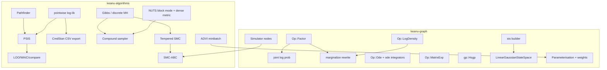
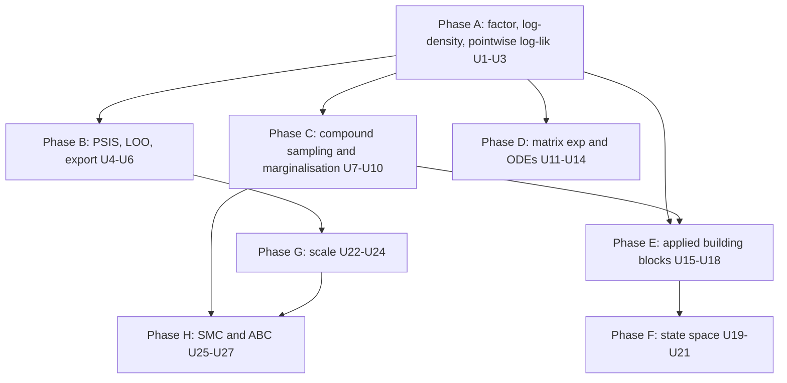

# Keanu Applied Modelling Gaps - Plan

## Goal Capsule

- **Objective:** close the gaps between Keanu and PyMC / TensorFlow Probability / Stan that block real-world applications, in the order of the 2026-11-05 gap analysis: (1) mixed discrete and continuous sampling and discrete marginalisation, (2) model comparison and export, (3) ODE solvers and the matrix exponential, (4) common applied building blocks (HSGP, sum-to-zero, factor terms, zero-inflated, hurdle and beta-binomial distributions, logit parameterisations), (5) a state-space toolkit, (6) scale (dense metric, Pathfinder, minibatch ADVI) and (7) tempered SMC with simulation-based (ABC) inference.
- **Authority:** this plan's Product Contract, then its Key Technical Decisions, then repo conventions (`CONTRIBUTING.md`, `docs/decisions/`). Java compatibility is not a constraint.
- **Execution profile:** phased; each unit leaves `main` green. Work on `main` of the fork (`fork` remote), run the Verification Contract before every commit, push after each unit, never `cargo publish`, never push to `origin`.
- **Stop conditions:** stop and ask if a unit needs a new dependency that isn't MIT/Apache/BSD compatible or that adds native code, or if a unit's design here proves unworkable in a way that changes public behaviour of existing features.
- **Tail ownership:** each unit updates its book chapter, rustdoc and `CHANGELOG.md` (a new section "Applied modelling gaps").

---

## Product Contract

### Summary

Keanu's core now handles continuous hierarchical models well. This plan adds what practitioners need next:
models with discrete latents sampled efficiently (compound NUTS + Gibbs) or summed out automatically;
LOO-PSIS / WAIC model comparison and CmdStan-CSV export for ArviZ and R's `posterior`;
ODE solvers with sensitivities and the matrix exponential for pharmacokinetics, epidemiology and continuous-time Markov models;
cheap, common building blocks (HSGP, sum-to-zero, factor nodes, zero-inflated, hurdle and beta-binomial counts, logit parameterisations);
Kalman smoothing, HMM decoding and structural time series for forecasting;
a dense mass matrix, Pathfinder and minibatch ADVI for scale;
and tempered SMC plus ABC for simulator models.

### Problem Frame

- A model with any discrete latent falls back to Metropolis–Hastings for every latent (`Sampler::for_model`), so mixed models mix poorly, and discrete latents can't be summed out without rewriting the model by hand.
- Users can fit models but can't compare them (no pointwise log-likelihood, LOO or WAIC) or hand the draws to standard tools.
- There is no way to write a model whose mean is the solution of an ODE or a linear system of ODEs.
- Applied models need pieces that are missing or awkward: arbitrary log-density terms, sum-to-zero effects, approximate GPs for long series, zero-inflated counts and numerically stable GLM likelihoods.
- The HMM and Kalman distributions give likelihoods but no way to recover or forecast the hidden states.
- Correlated posteriors need a dense metric; large data needs subsampling; fast approximate posteriors and initialisation need Pathfinder.
- Simulator models without a tractable likelihood, Keanu's original use case, have no inference method.

### Requirements

**Foundations**
- R1. A factor node adds an arbitrary differentiable f64 expression (summed) to the joint log probability.
- R2. A log-density op evaluates the element-wise log density of a value under an element-wise distribution as a deterministic, differentiable node.
- R3. The pointwise log-likelihood of every observation element (element-wise kinds) or observed node (other kinds) is available for each posterior draw.

**Model comparison and export**
- R4. PSIS (Pareto-smoothed importance sampling) with the k̂ diagnostic.
- R5. PSIS-LOO and WAIC estimates with standard errors and pointwise values; model comparison tables with elpd differences, their standard errors, and stacking and pseudo-BMA weights.
- R6. Multi-chain samples, sampler statistics and pointwise log-likelihoods export to CmdStan CSV that ArviZ (`from_cmdstan`) and R `posterior` read.

**Mixed discrete sampling**
- R7. NUTS can sample a subset of continuous latents while other latents are held fixed and updated by other steps.
- R8. Gibbs steps update discrete latents with finite support by exact enumeration, element by element; discrete latents with infinite support get a Metropolis step with a discrete proposal.
- R9. A compound sampler cycles steps over disjoint latent blocks and becomes the default for models with both discrete and continuous latents.
- R10. Finite-support discrete latents can be marginalised automatically, and their posterior probabilities recovered from the draws.

**ODEs and the matrix exponential**
- R11. A matrix-exponential op with exact first and second derivatives.
- R12. An ODE op solves dy/dt = f(t, y, θ) at given output times with a non-stiff (Dormand–Prince 5(4)) and a stiff (Rosenbrock) solver, with gradients by forward sensitivities. Solver failure makes the log probability impossible rather than aborting inference.
- R13. Worked examples: an SIR epidemic model, a one-compartment oral-dose pharmacokinetic model, and a multi-state model with the matrix exponential.

**Applied building blocks**
- R14. Hilbert-space approximate GPs (HSGP) for the exponentiated-quadratic and Matérn kernels in one or more input dimensions.
- R15. A sum-to-zero vector support with its transform, and a `ZeroSumNormal` distribution.
- R16. New distributions: BetaBinomial; ZeroInflated and Hurdle wrappers; logit and log parameterisations (`BernoulliLogit`, `BinomialLogit`, `PoissonLog`, `CategoricalLogit`).
- R17. A worked example using zero inflation or marginalisation on an ecology occupancy model.

**State space**
- R18. Kalman (RTS) smoothing, forward-filtering backward-sampling and forecasting for the linear-Gaussian state-space model; Viterbi decoding, posterior state marginals and FFBS for the HMM.
- R19. Time-series distributions: GaussianRandomWalk, AR(p) and GARCH(1,1).
- R20. A structural time-series module (local level, local linear trend, seasonal, regression and AR components) that builds a linear-Gaussian state-space model, decomposes the fit and forecasts, with an example.

**Scale**
- R21. NUTS adapts a dense mass matrix on request.
- R22. Pathfinder (single and multi-path) returns approximate draws and can initialise NUTS chains.
- R23. ADVI can subsample observations each iteration with the log-likelihood scaled to the full data size.

**Simulators**
- R24. Tempered SMC samples any model and estimates the log marginal likelihood.
- R25. Simulator nodes (a user function from parameters to simulated data) with an ABC kernel, sampled by SMC-ABC, with an example.

### Acceptance Examples

- AE1. A Gaussian mixture written with an explicit Categorical assignment per point, marginalised automatically, has the same log probability as the same model written with `Mixture`, and the compound sampler on the unmarginalised model recovers the same component means.
- AE2. The coal-mining change-point example (discrete switch point) uses the compound sampler by default, and every R-hat is below 1.01.
- AE3. On the eight-schools model, PSIS-LOO elpd agrees with ArviZ's published value for the centred model within its standard error, and k̂ values are reported per school.
- AE4. A CmdStan CSV written by Keanu is read back by a parser in the tests that follows ArviZ's `from_cmdstan` rules, with the same draws and the sampler columns `lp__`, `accept_stat__`, `stepsize__`, `treedepth__`, `n_leapfrog__`, `divergent__`, `energy__`.
- AE5. The SIR model fitted with NUTS recovers β and γ used to simulate the data within their 90% intervals, and the ODE gradient matches finite differences to 1e-6 relative.
- AE6. An HSGP with 40 basis functions approximates the exact exponentiated-quadratic covariance to 1e-3 on [−1, 1] with lengthscale 0.3.
- AE7. On a 2-D Gaussian with correlation 0.99, dense-metric NUTS reaches bulk ESS per gradient at least 5× the diagonal metric's.
- AE8. Tempered SMC estimates the log evidence of a conjugate Gaussian model to within 0.1 of the closed form, and samples both modes of a symmetric bimodal target in proportion.

### Scope Boundaries

- GPU, SIMD, vectorised chains, JIT compilation and Python/R bindings are out.
- DAE solvers, adjoint ODE sensitivities, PDEs and delay differential equations are out. ODE second derivatives return `NoSecondOrderRule`, so the Laplace approximation doesn't support ODE models.
- Random variables inside scan or ODE bodies remain out.
- Sparse matrices, ICAR/CAR, sparse/variational GPs, normalising flows and BART are out.
- NetCDF/InferenceData writing is out (no native HDF5); CmdStan CSV is the interchange format.
- Marginalisation supports only the dependency patterns in KTD5; anything else is rejected with an error.
- Publishing to crates.io is out.

#### Deferred to Follow-Up Work

- Adjoint sensitivities for large ODE systems; DAEs; algebraic solvers and `integrate_1d`.
- ICAR/BYM2 with sparse matrices.
- Euler–Maruyama SDE distributions.
- SMC with gradient-based mutation kernels.
- K-fold cross-validation helpers and moment-matching LOO.

---

## Planning Contract

### Key Technical Decisions

- KTD1. **Factor and log-density are ordinary ops.** `Op::Factor` is a deterministic f64 node whose summed value the joint log probability includes (like PyMC's `Potential` or Stan's `target +=`); `Graph`/`logprob` treat factor nodes as log-probability contributors next to probabilistic nodes, with gradients and HVPs through the ordinary autodiff of their parent. `Op::LogDensity(DistributionKind)` takes the value and parameters as parents and returns the element-wise log density via `DistributionKind::univariate`; it is defined only for element-wise kinds and its derivatives reuse the univariate gradient and second-order rules. Both are saveable.
- KTD2. **Pointwise log-likelihood is per element for element-wise kinds, per node otherwise**, matching how PyMC/ArviZ label `log_likelihood` variables. It is computed from recorded draws by setting each draw's latents and evaluating observed nodes, so it works for every sampler and for Laplace/ADVI/Pathfinder draws. Samplers don't record it by default.
- KTD3. **PSIS and LOO follow Vehtari, Simpson, Gelman, Yao and Gabry (2024) and the R `loo` package (2.8)**: tail length `min(0.2·S, 3·sqrt(S))`, generalized Pareto fit by Zhang and Stephens (2009) with the weakly informative prior on k, k̂ thresholds `min(1 − 1/log10(S), 0.7)`, truncation at `S^{3/4}` mean weight. Stacking weights maximise the log score on the simplex (L-BFGS on the softmax parameterisation); pseudo-BMA+ uses the Bayesian bootstrap (Yao et al. 2018).
- KTD4. **Compound sampling reuses existing steps.** `NutsSampler` gains a block mode: it parameterises only the given continuous latents and, before each step, refreshes its cached position, log probability and gradient from the state (other blocks changed it). Step-size and metric adaptation continue across the compound sampler's warm-up. Gibbs on finite-support kinds (Bernoulli, Categorical, UniformInt, Binomial up to a size limit, OrderedLogistic, BetaBinomial, ZeroInflated over a finite kind) enumerates each element's values using `Model::log_prob_after`-style incremental evaluation on the Markov blanket; infinite-support kinds (Poisson, NegativeBinomial, Geometric) use a symmetric ±1/±2 random-walk Metropolis step per element. `Sampler::for_model` returns `Compound` when both kinds of latent exist; all-continuous stays NUTS and all-discrete becomes Gibbs.
- KTD5. **Marginalisation is a graph rewrite to a factor.** `marginalize(graph, node)` returns a new `Graph` and a `Marginalized` record. Supported: a finite-support element-wise discrete latent `z` of shape S (scalar or vector) whose dependent probabilistic nodes ("children") are element-wise kinds and are reached from `z` only through element-wise ops, `Gather` with `z` as the index, `Where`/`Multiplexer` with `z` in the condition, `Cast`, and broadcasting, such that every child's shape starts with S (extra trailing axes are summed). For each value k the dependent deterministic path is cloned with `z` replaced by the constant k, each child's log density is evaluated with `LogDensity`, trailing axes are summed to S, `log p(z = k)` is added, the K results are stacked and `logsumexp`-ed over k, and the sum becomes a `Factor`. The children's own log-probability contributions are removed (they become observed constants of the factor); `z` and its children leave the probabilistic set. A scalar `z` with children of any shape is supported by summing children completely. Anything else is rejected with `GraphError::CannotMarginalize` naming the blocking node. `recover_marginals(marginalized, samples)` returns p(z = k | draw) per element and can draw z.
- KTD6. **Matrix exponential by scaling and squaring with Padé approximants (Higham 2005, `expm` degree selection 3/5/7/9/13).** Its Fréchet derivative L(A, E) is the upper-right block of exp([[A, E], [0, A]]); the VJP is L(Aᵀ, Ḡ); the second-order rule uses the 3×3 block form. Lives in `keanu-tensor` (`linalg`) and as `Op::MatrixExp`.
- KTD7. **ODEs are a nested-graph op like scan.** `Op::Ode(Arc<OdeBody>)`: a body graph with placeholders t (scalar), y ([n]) and θ (constants, any number of f64 parents) and one output dy/dt ([n]); the op's parents are y0, the output times (a constant or observed f64 vector, strictly increasing, starting after t0), t0 and the θ parents; its value is [T, n]. Integrators (Dormand–Prince 5(4) with dense output following Hairer, Nørsett and Wanner; Rodas4-style Rosenbrock with an exact Jacobian from the body's forward-mode autodiff, following Hairer and Wanner) live in `keanu-graph/src/ode/` and are generic over closures on `&[f64]`. Gradients integrate the forward-sensitivity system (Jacobians from body JVPs) alongside y, with error control over states only (Stan's default is to include sensitivities; we follow CVODES' `errconS = true` and include them). Tolerances default to Stan's (rtol 1e-6, atol 1e-6, max steps 1e6). The reverse rule contracts output seeds with stored sensitivity matrices at the output times. Second-order returns `NoSecondOrderRule`. A solver failure (step-size underflow, max steps, non-finite state) evaluates to a new `GraphError::SolverFailed`, which `Model::log_prob*` and the algorithms treat as an impossible point (NUTS: divergence/rejection; optimizers: rejected step), never a crash.
- KTD8. **HSGP follows Riutort-Mayol et al. (2023)**: Laplacian eigenfunctions on [−L, L]ᵈ with L = c·max|x − centre|, m basis functions per dimension (full tensor grid), weights β ~ N(0, 1), f = Φ (sqrt(S(√λ)) ⊙ β) with the kernel's spectral density S. It builds with existing ops (constants, matmul, elementwise), so its derivatives come for free. Spectral densities: exponentiated quadratic and Matérn 1/2, 3/2, 5/2.
- KTD9. **Sum-to-zero uses Stan 2.36's isometric transform** (`sum_to_zero_vector`: N−1 unconstrained values through the Helmert-like orthonormal basis) as `Support::SumToZero` and `transform::SumToZero`. `ZeroSumNormal(sigma)` on shape [N] has density of N(0, σ²I) restricted to the subspace (PyMC's definition: no −log J term because the transform is isometric).
- KTD10. **ZeroInflated and Hurdle are nested kinds like `Truncated`.** `ZeroInflated(kind)` with parameters [ψ (structural-zero probability), inner params...] on a discrete inner kind; `Hurdle(kind)` with [ψ (probability of zero), inner params...] on a discrete inner kind (truncated at zero, via its CDF) or a positive continuous inner kind (point mass at 0, by the convention of a value exactly 0). Logit/log parameterisations are separate kinds with numerically stable densities (log1p-exp forms) and full first/second-order rules.
- KTD11. **State-space post-processing is post hoc on draws.** Smoother, FFBS, Viterbi and forecasts are functions of a node's parameter values in a state; posterior versions run them for each draw of a `NetworkSamples`. The RTS smoother uses the same Joseph-form filter as the distribution. Forecasting extends the state-space parameters h steps (time-invariant models, or user-supplied future matrices).
- KTD12. **Structural time series is a builder, not a distribution.** `sts::Model` assembles component matrices into one `LinearGaussianStateSpace` node from graph variables (component scales are latents), exactly as `tfp.sts` does, and provides `decompose` and `forecast` over posterior draws.
- KTD13. **Dense metric follows Stan's windowed adaptation**: regularised sample covariance `(n/(n+5))·Σ + 1e-3·(5/(n+5))·I` per window, applied as M⁻¹; momentum drawn with the Cholesky factor of M. `QuadraticPotential` gains `with_metric(Metric::Diagonal | Metric::Dense)`.
- KTD14. **Pathfinder follows Zhang, Carpenter, Gelman and Vehtari (2022)** and Stan's defaults: L-BFGS (history 6) path in unconstrained space, a normal approximation at each iterate from the L-BFGS inverse-Hessian factors, ELBO estimated with 5 draws per iterate, best iterate chosen; multi-path runs 4 paths and resamples 1000 draws with PSIS (U4). `Nuts` can start each chain from a Pathfinder draw.
- KTD15. **Minibatching scales observed nodes' log-likelihood.** `Parameterisation` gains per-node log-probability weights; `Advi::with_minibatch(Minibatch)` holds groups of (observed node, full data tensor along axis 0) plus covariate constant nodes that share the same row indices, a batch size B and total N; each iteration observes a fresh random batch (without replacement within an epoch) and weights the observed nodes by N/B. Shapes stay fixed at B. ELBO convergence uses the running mean of the noisy ELBO.
- KTD16. **SMC follows PyMC's `sample_smc` (Ching and Chen 2007; Minson et al. 2013)**: particles from the prior, adaptive tempering so the effective sample size drops to a threshold (0.5) each stage, systematic resampling, and an independent Metropolis–Hastings mutation kernel with a multivariate normal proposal fitted to the particles in unconstrained space (correlation tuning by acceptance rate). The log marginal likelihood is the sum of each stage's log mean incremental weight. Discrete latents are mutated with the Gibbs steps of U8.
- KTD17. **Simulators are a probabilistic node kind with no likelihood.** `builder.simulator(fn, params, shape)` makes a node whose sample is a user closure of its parameters' values and RNG; it can only be observed; ABC replaces its log likelihood by a kernel `−½·‖(s(sim) − s(obs))/ε‖²` (Gaussian) or `−‖…‖₁/ε` (Laplace) with optional summary statistics, and SMC-ABC tempers it like a likelihood. Simulator nodes are not saveable (like lambdas).

### High-Level Technical Design

### Phase Map

Phases run in letter order. U18's occupancy example needs U10 and U17. U23 needs U4. U25 needs U8.

### Assumptions

- `DistributionKind::univariate` provides element-wise log densities and gradients for every element-wise kind; second-order element-wise rules exist in `op/distribution_hvp/rules.rs`.
- The nested-graph machinery of `Op::Scan` (`op/nested.rs`) can host the ODE body, including forward-mode JVPs of the body.
- The boarding-school influenza data (BMJ 1978, 14 daily counts) and R's `Theoph` data (in R's `datasets`, GPL-compatible facts, reproduced as a 12×11 table of numbers) are usable as small embedded data; otherwise examples use simulated data.

---

## Implementation Units

### Unit Index

| U-ID | Title | Key files | Depends on |
|---|---|---|---|
| U1 | Factor node | `keanu-graph/src/op/mod.rs`, `keanu-graph/src/logprob.rs`, `keanu-io` | none |
| U2 | Log-density op | `keanu-graph/src/op/`, `keanu-graph/src/autodiff/` | U1 |
| U3 | Pointwise log-likelihood | `keanu-algorithms/src/loglik.rs` | none |
| U4 | PSIS | `keanu-algorithms/src/psis.rs` | none |
| U5 | LOO, WAIC and comparison | `keanu-algorithms/src/loo.rs` | U3, U4 |
| U6 | CmdStan CSV export | `keanu-algorithms/src/export.rs` | U3 |
| U7 | NUTS block mode | `keanu-algorithms/src/mcmc/nuts.rs` | none |
| U8 | Gibbs and discrete Metropolis steps | `keanu-algorithms/src/mcmc/gibbs.rs` | none |
| U9 | Compound sampler | `keanu-algorithms/src/mcmc/compound.rs`, `select.rs` | U7, U8 |
| U10 | Automatic marginalisation | `keanu-graph/src/marginalize.rs` | U1, U2 |
| U11 | Matrix exponential | `keanu-tensor/src/ops/linalg.rs`, `keanu-graph` | none |
| U12 | ODE integrators | `keanu-graph/src/ode/` | none |
| U13 | ODE op | `keanu-graph/src/op/ode.rs`, `keanu-io` | U12 |
| U14 | ODE and multi-state examples, book chapter | `keanu/examples/`, `book/src/differential-equations.md` | U11, U13 |
| U15 | HSGP | `keanu-graph/src/gp.rs` | none |
| U16 | Sum-to-zero and ZeroSumNormal | `keanu-graph/src/transform/`, distributions | none |
| U17 | Count distributions and logit parameterisations | `keanu-distributions/src/discrete.rs`, `op/wrappers.rs` | none |
| U18 | Occupancy example | `keanu/examples/occupancy.rs` | U9, U10, U17 |
| U19 | Smoothing, decoding and forecasting | `keanu-distributions/src/timeseries.rs`, `keanu-algorithms/src/timeseries.rs` | none |
| U20 | Time-series distributions | `keanu-distributions/src/timeseries.rs` | none |
| U21 | Structural time series and forecasting example | `keanu-graph/src/sts.rs`, `keanu/examples/` | U19 |
| U22 | Dense mass matrix | `keanu-algorithms/src/mcmc/nuts.rs` | U7 |
| U23 | Pathfinder | `keanu-algorithms/src/vi/pathfinder.rs` | U4 |
| U24 | Minibatch ADVI | `keanu-graph/src/parameterisation.rs`, `keanu-algorithms/src/vi/advi.rs` | none |
| U25 | Tempered SMC | `keanu-algorithms/src/smc.rs` | U8 |
| U26 | Simulator nodes and SMC-ABC | `keanu-graph/src/op/`, `keanu-algorithms/src/smc.rs` | U25 |
| U27 | SMC and ABC examples, book chapter | `keanu/examples/`, `book/src/` | U26 |

### Phase A: foundations

### U1. Factor node

- **Goal:** arbitrary terms in the joint log probability.
- **Requirements:** R1.
- **Files:** `keanu-graph/src/op/mod.rs`, `keanu-graph/src/logprob.rs`, `keanu-graph/src/model.rs`, `keanu-graph/src/builder.rs` (`factor`), `keanu-graph/src/parameterisation.rs`, `keanu-graph/src/autodiff/`, `keanu-io/proto/keanu/graph.proto`, `keanu-io/src/{save,load}.rs`, `keanu-graph/tests/factor.rs`, `book/src/building-models.md`.
- **Approach:** per KTD1. `GraphBuilder::factor(expr)` returns a `NodeId`. `Model` lists factor nodes; `log_prob`, `log_likelihood` (factors count as likelihood unless labelled prior via `factor_prior`? keep one: factors count in the joint and in `log_likelihood`), gradient and HVP include them. MH incremental `log_prob_after` includes affected factors.
- **Test scenarios:** a factor of `-0.5·x²` on an improper flat latent reproduces a standard normal under NUTS (moments); gradient and HVP match finite differences; a factor with non-finite value makes the state impossible; save/load round trip; MH respects factors.
- **Implementation note:** `GraphBuilder::factor` returns a `DoubleVar` (so the factor can be labelled) rather than a bare `NodeId`. Keanu has no improper flat distribution, so the NUTS test uses a wide `Uniform(-20, 20)` prior, whose truncation of the standard normal is negligible. A factor's term is its value, or −∞ where that is not finite (NaN, +∞ or −∞).

### U2. Log-density op

- **Goal:** element-wise log densities as graph values.
- **Requirements:** R2.
- **Files:** `keanu-graph/src/op/mod.rs`, `keanu-graph/src/op/eval.rs`, `keanu-graph/src/autodiff/{mod,second_order}.rs`, `keanu-graph/src/vars.rs` or `builder.rs` (`log_density(kind, value, params)`), `keanu-io`, `keanu-graph/tests/log_density.rs`.
- **Approach:** per KTD1; reject non-element-wise kinds at build. Value may be f64 or i64 (discrete kinds); gradients only flow to f64 parents.
- **Test scenarios:** summed `LogDensity` equals the distribution node's log prob for Gaussian, Gamma, Poisson, NegativeBinomial, Truncated(Gaussian); VJP/JVP/HVP match finite differences; a multivariate kind is rejected; save round trip.
- **Implementation note:** the builder method is `GraphBuilder::log_density(kind, value, parameters)` with `value` any handle and `parameters` node ids (as `mixture` takes them); the rules live in `keanu-graph/src/op/log_density.rs`. "Element-wise" is `DistributionKind::is_elementwise`, so the Bernoulli (whose value is bool) and mixtures are rejected along with the multivariate kinds.

### U3. Pointwise log-likelihood

- **Goal:** per-observation log-likelihood matrices for LOO/WAIC and export.
- **Requirements:** R3.
- **Files:** `keanu-algorithms/src/loglik.rs`, `keanu-algorithms/src/lib.rs`, `keanu-algorithms/tests/loglik.rs`.
- **Approach:** per KTD2. `PointwiseLogLik { names: Vec<String>, values: [chains][draws][n] }` from `ChainSamples` (or single `NetworkSamples`) and the model; requires samples recording every latent the observed nodes depend on (error naming missing nodes otherwise). Factor nodes are excluded with a note in the docs. Parallel over draws with the `parallel` feature.
- **Test scenarios:** sum over points equals `Model::log_likelihood` at each draw; element labels `y[3]`; MVN observed node gives one column; missing latent errors.
- **Implementation note:** the API is `PointwiseLogLik::from_chains(model, state, &ChainSamples)` and `from_samples(model, state, &NetworkSamples)`, with `points()` (`LogLikPoint { node, index, name }`), `names()`, `values()`, `chain(c)`, `point(i)` (all draws, chain after chain) and `totals()`. "Element-wise" here is wider than `is_elementwise`: the points are the unreduced terms of each node's log probability (the new `keanu_graph::node_log_prob_terms`), so the Bernoulli, categorical, ordered logistic and mixtures have one point per element too. Multivariate kinds reduce over their whole value, so a batch of multivariate Gaussian vectors is one point. At least one draw is required, since the points' shapes are read from the first draw.

### Phase B: model comparison and export

### U4. PSIS

- **Requirements:** R4. **Files:** `keanu-algorithms/src/psis.rs`, `keanu-algorithms/tests/psis.rs`.
- **Approach:** per KTD3; returns smoothed log weights and k̂; `gpdfit` public.
- **Test scenarios:** k̂ for draws of known generalized Pareto tails (k = 0.3, 0.8) within 0.1; reference values computed with the R `loo` algorithm on a fixed vector committed as a fixture (generated offline from the published algorithm, recorded in the test); smoothed weights are non-decreasing in the raw weights' order in the tail; constant ratios give k̂ = −∞ or NaN handled gracefully.

### U5. LOO, WAIC and comparison

- **Requirements:** R5. **Files:** `keanu-algorithms/src/loo.rs`, `keanu-algorithms/tests/loo.rs`, `keanu/examples/eight_schools.rs` (reports LOO), `book/src/model-comparison.md`, `book/src/SUMMARY.md`.
- **Approach:** `loo(&PointwiseLogLik) -> Loo { elpd, se, p_loo, looic, pointwise, pareto_k, warnings }` with MCSE of elpd via relative efficiency from multi-chain ESS (as `loo::relative_eff`); `waic`; `compare(&[(&str, &Loo)]) -> Comparison` sorted by elpd with `elpd_diff`, `se_diff`; `stacking_weights`, `pseudo_bma_weights`.
- **Test scenarios:** for a conjugate normal model, LOO elpd matches the exact leave-one-out predictive density computed analytically within MCSE; WAIC close to LOO; covers AE3; compare of a correct vs a wrong model ranks the correct one first with positive diff; stacking weights sum to 1 and put ≥0.9 on a dominant model.

### U6. CmdStan CSV export

- **Requirements:** R6. **Files:** `keanu-algorithms/src/export.rs`, `keanu-algorithms/tests/export.rs`, `book/src/inference-sampling.md`.
- **Approach:** one CSV per chain in CmdStan format: `#` comment header with model name, sampler settings and adaptation (step size, diagonal of inverse metric), a column header with Stan's dotted indices (`theta.1`, `L.2.1`, column-major for matrices as Stan writes them), sampler columns from `NutsStatistics` (zeros/NaN-free defaults for MH), `log_lik.i` columns from U3 when given. Write to any `io::Write`.
- **Test scenarios:** covers AE4 with a reader in the test that mirrors ArviZ's `from_cmdstan` parsing (comment lines, header, sampler columns, column-major reshape); names with indices; MH samples write without NUTS columns' garbage.

### Phase C: mixed discrete sampling and marginalisation

### U7. NUTS block mode

- **Requirements:** R7. **Files:** `keanu-algorithms/src/mcmc/nuts.rs`, `keanu-graph/src/parameterisation.rs` (construct over a chosen subset of continuous latents), `keanu-algorithms/tests/mcmc_nuts.rs`.
- **Approach:** per KTD4: `Nuts::block_sampler(model, state, latents, record_nodes, rng)` (or an option on `sampler`) that parameterises only `latents`; `NutsSampler::refresh(state)` recomputes the cached candidate; `step` calls it when the state's values of non-block latents changed (track a cheap generation counter or always refresh in block mode). The whole-model check that rejects discrete latents is relaxed in block mode.
- **Test scenarios:** block NUTS over x in a model with a fixed discrete latent samples the conditional posterior exactly (moments); after externally changing a discrete latent, the next step uses the new conditional (log prob consistent); existing NUTS tests unchanged.

### U8. Gibbs and discrete Metropolis steps

- **Requirements:** R8. **Files:** `keanu-algorithms/src/mcmc/gibbs.rs`, `keanu-algorithms/tests/mcmc_gibbs.rs`.
- **Approach:** per KTD4. `Gibbs::new(nodes)` implementing `SamplingAlgorithm`; enumerates each element's support (size cap, default 1000, else error suggesting MH); incremental log prob over the Markov blanket via `Model::log_prob_after`; `DiscreteMetropolis` for infinite support with symmetric random-walk proposals.
- **Test scenarios:** Gibbs on a Bernoulli latent with an observed Gaussian child matches the exact posterior probability; a Categorical vector latent's elements update independently and match exact conditionals; Poisson latent via DiscreteMetropolis matches a conjugate Gamma-Poisson posterior predictive count distribution; an UniformInt change point matches enumeration.

### U9. Compound sampler

- **Requirements:** R9. **Files:** `keanu-algorithms/src/mcmc/compound.rs`, `keanu-algorithms/src/mcmc/select.rs`, `keanu-algorithms/src/mcmc/chains.rs`, `keanu/examples/coal_mining_disasters.rs`, `keanu/examples/cheating_students.rs` (if discrete), `book/src/inference-sampling.md`.
- **Approach:** `Compound::new().nuts(continuous).gibbs(discrete)` or `Compound::for_model`; warm-up adapts NUTS while cycling; statistics from the NUTS block; `Sampler::Compound` and `Sampler::Gibbs` variants and the new default rules from KTD4; multi-chain via `sample_chains`.
- **Test scenarios:** covers AE2; covers AE1's sampler half; a spike-and-slab regression with Bernoulli indicators recovers the true inclusion pattern; all-discrete models default to Gibbs; existing MH users who call `MetropolisHastings` explicitly are unaffected.

### U10. Automatic marginalisation

- **Requirements:** R10. **Files:** `keanu-graph/src/marginalize.rs`, `keanu-graph/src/error.rs` (`CannotMarginalize`), `keanu-graph/src/graph.rs` (cloning helpers), `keanu-algorithms/src/predictive.rs` or a new `marginal.rs` (`recover_marginals`), `keanu-graph/tests/marginalize.rs`, `keanu/examples/gaussian_mixture.rs` (variant), `book/src/building-models.md`.
- **Approach:** per KTD5. `marginalize(&graph, &[z]) -> Result<(Graph, Marginalized)>` that also maps old to new `NodeId`s (labels preserved); several latents marginalised one after another.
- **Test scenarios:** covers AE1 (log prob equal to the `Mixture` model at random parameter values, gradients equal); change point (scalar UniformInt) matches brute-force enumeration; vector Bernoulli occupancy with a [N, J] child sums trailing axes; a child reached through a matmul is rejected naming the matmul; `recover_marginals` probabilities sum to 1 and match exact posteriors on a two-component mixture; NUTS on the marginalised mixture converges (R-hat < 1.01).

### Phase D: matrix exponential and ODEs

### U11. Matrix exponential

- **Requirements:** R11. **Files:** `keanu-tensor/src/ops/linalg.rs`, `keanu-tensor/tests/linalg.rs`, `keanu-graph/src/op/mod.rs`, `keanu-graph/src/autodiff/`, `keanu-graph/src/vars.rs` (`matrix_exp`), `keanu-io`.
- **Approach:** per KTD6, batched over leading axes like the other linalg ops.
- **Test scenarios:** exp of diagonal, nilpotent, rotation generator and a 2-state CTMC generator against closed forms to 1e-13; large-norm matrices (scaling path); VJP/JVP/HVP match finite differences; rows of exp(Qt) of a generator sum to 1.

### U12. ODE integrators

- **Requirements:** R12. **Files:** `keanu-graph/src/ode/{mod,dopri5,rosenbrock}.rs`, `keanu-graph/tests/ode_solvers.rs`.
- **Approach:** per KTD7; `OdeSolver::{Rk45, Stiff}`, tolerances, max steps; dense output for Dormand–Prince; Rosenbrock (Rodas4 coefficients from Hairer and Wanner, with embedded error estimate) solving linear systems with `keanu-tensor` LU; both expose an `integrate(f, jac, t0, y0, ts) -> Result<Vec<Vec<f64>>, SolverFailed>` API.
- **Test scenarios:** exponential decay, harmonic oscillator and Lotka–Volterra against closed forms/high-precision references at rtol 1e-8; Robertson's stiff problem with the stiff solver against published reference values (Hairer and Wanner), and the non-stiff solver hitting max steps returns `SolverFailed`; output times equal to t0 or decreasing are rejected.

### U13. ODE op

- **Requirements:** R12. **Files:** `keanu-graph/src/op/ode.rs`, `keanu-graph/src/op/nested.rs`, `keanu-graph/src/builder.rs` (`ode`), `keanu-graph/src/autodiff/`, `keanu-graph/src/model.rs` / `logprob.rs` (solver failure → impossible), `keanu-algorithms` (treat `SolverFailed` as impossible in NUTS, optimizers, ADVI), `keanu-io`, `keanu-graph/tests/ode.rs`.
- **Approach:** per KTD7; builder closure like `scan`: `builder.ode(y0, ts, t0, theta, solver, |b, t, y, theta| dydt)`.
- **Test scenarios:** value matches U12 directly; gradients w.r.t. y0, θ, t0 match finite differences to 1e-6 relative (AE5 part); HVP returns `NoSecondOrderRule`; a failing solve inside NUTS is counted as a divergence and sampling continues; save/load round trip of an ODE body.

### U14. ODE and multi-state examples, book chapter

- **Requirements:** R13. **Files:** `keanu/examples/sir.rs`, `keanu/examples/pharmacokinetics.rs`, `keanu/examples/multi_state.rs`, `keanu/tests/examples.rs`, `book/src/differential-equations.md`, `book/src/examples.md`, `book/src/SUMMARY.md`, `keanu/tests/book.rs`.
- **Approach:** SIR on the boarding-school data with a negative binomial likelihood (as in the Stan case study by Grinsztajn et al.); one-compartment first-order absorption PK with an analytic-solution cross-check; a 3-state illness-death model with transition intensities through `matrix_exp` and interval-censored observations.
- **Test scenarios:** covers AE5 (on simulated data with known parameters for the assertion, the real data for the illustration); PK ODE fit agrees with the analytic-solution model; multi-state recovers simulated intensities; examples run as tests within the existing time budget.

### Phase E: applied building blocks

### U15. HSGP

- **Requirements:** R14. **Files:** `keanu-graph/src/gp.rs` (or `gp/hsgp.rs`), `keanu-graph/tests/gp.rs`, `keanu/examples/gp_regression.rs` (HSGP section), `book/src/gaussian-processes.md`.
- **Approach:** per KTD8; `Hsgp::new(kernel, m, c)` with `prior(x)` returning f and the β node, `predict` at new inputs from the same β; multi-dimensional inputs; error for kernels without a spectral density.
- **Test scenarios:** covers AE6; Matérn kernels likewise; 2-D input approximation; NUTS on a 1,000-point series converges and agrees with the exact GP's posterior mean on a 200-point subset within tolerance.

### U16. Sum-to-zero and ZeroSumNormal

- **Requirements:** R15. **Files:** `keanu-graph/src/transform/sum_to_zero.rs`, `keanu-graph/src/op/distribution.rs`, `keanu-distributions/src/multivariate.rs`, `keanu-io`, tests, `keanu/examples/radon.rs` (a sum-to-zero variant or note), `book/src/building-models.md`.
- **Approach:** per KTD9, transform with forward/inverse/log-det (0)/JVP/VJP/second order.
- **Test scenarios:** round trip; output sums to 0 to 1e-12; ZeroSumNormal draws have marginal variance σ²(N−1)/N; NUTS on a one-way ANOVA with a sum-to-zero effect recovers effects; HVP via finite differences.

### U17. Count distributions and logit parameterisations

- **Requirements:** R16. **Files:** `keanu-distributions/src/discrete.rs`, `keanu-distributions/src/cdf.rs`, `keanu-graph/src/op/distribution.rs`, `keanu-graph/src/op/wrappers.rs`, `keanu-graph/src/op/distribution_hvp/rules.rs`, `keanu-graph/src/builder.rs`, `keanu-io`, tests, `book/src/building-models.md`.
- **Approach:** BetaBinomial(n, α, β) with CDF (sum for small n); ZeroInflated / Hurdle per KTD10; BernoulliLogit, BinomialLogit, PoissonLog, CategoricalLogit; supports, samplers, gradients, second-order rules, mixtures where element-wise.
- **Test scenarios:** pmfs sum to 1; log densities against closed forms at extreme logits (±700) without overflow; gradients and HVPs against finite differences; samplers' moments; zero-inflated Poisson NUTS recovers ψ and λ; hurdle Gamma for continuous data with zeros.

### U18. Occupancy example

- **Requirements:** R17. **Files:** `keanu/examples/occupancy.rs`, `keanu/tests/examples.rs`, `book/src/examples.md`.
- **Approach:** simulated site-occupancy data (N sites × J surveys), written once with a Bernoulli occupancy latent sampled by the compound sampler and once marginalised; both agree.
- **Test scenarios:** both formulations recover ψ and p within 90% intervals and agree with each other.

### Phase F: state space

### U19. Smoothing, decoding and forecasting

- **Requirements:** R18. **Files:** `keanu-distributions/src/timeseries.rs`, `keanu-algorithms/src/timeseries.rs`, tests, `book/src/sequences.md`.
- **Approach:** per KTD11: `LinearGaussianStateSpace::{filter, smooth, sample_states, forecast}`, `HiddenMarkovChain::{viterbi, posterior_marginals, sample_states}`; posterior versions over draws for a node.
- **Test scenarios:** RTS smoother equals the exact Gaussian conditional from the full joint covariance on a small model; FFBS draws' moments match the smoother; Viterbi equals brute-force argmax on a short sequence; HMM marginals equal brute-force enumeration; forecasts of a local-level model have the closed-form variance growth.

### U20. Time-series distributions

- **Requirements:** R19. **Files:** `keanu-distributions/src/timeseries.rs`, `keanu-graph/src/op/distribution.rs`, rules, `keanu-io`, tests.
- **Approach:** GaussianRandomWalk(μ drift, σ, init), AR(p)(ρ[p], σ, init dist via constant/stationary), GARCH(1,1)(ω, α, β, initial vol); log densities, gradients, HVPs, samplers.
- **Test scenarios:** log density equals the unrolled graph's; gradients/HVPs finite differences; sampled series statistics; GARCH stationarity constraint error.

### U21. Structural time series and forecasting example

- **Requirements:** R20. **Files:** `keanu-graph/src/sts.rs`, `keanu-algorithms/src/timeseries.rs`, `keanu/examples/co2_forecast.rs` (simulated or public-domain NOAA Mauna Loa monthly CO₂ data), `book/src/sequences.md`.
- **Approach:** per KTD12.
- **Test scenarios:** a local linear trend + seasonal model built by `sts` equals the hand-built LGSSM log density; decomposition components sum to the smoothed mean; the example's 2-year forecast interval covers held-out data at the nominal rate on simulated data.

### Phase G: scale

### U22. Dense mass matrix

- **Requirements:** R21. **Files:** `keanu-algorithms/src/mcmc/nuts.rs`, `keanu-algorithms/tests/mcmc_nuts.rs`, `book/src/inference-sampling.md`, `docs/benchmarks.md`.
- **Approach:** per KTD13.
- **Test scenarios:** covers AE7; dense adaptation on an uncorrelated target matches diagonal results; the adapted metric approximates the posterior covariance.

### U23. Pathfinder

- **Requirements:** R22. **Files:** `keanu-algorithms/src/vi/pathfinder.rs`, `keanu-algorithms/src/mcmc/nuts.rs` (initialisation helper), tests, `book/src/inference-vi.md`.
- **Approach:** per KTD14.
- **Test scenarios:** on a correlated Gaussian the draws' mean and covariance match within tolerance; on eight schools the multi-path draws' means are near NUTS's; Pathfinder-initialised NUTS reaches stationarity (R-hat) with a shorter warm-up than default initialisation on the radon model; PSIS k̂ reported.

### U24. Minibatch ADVI

- **Requirements:** R23. **Files:** `keanu-graph/src/parameterisation.rs` (weights), `keanu-algorithms/src/vi/advi.rs`, tests, `book/src/inference-vi.md`.
- **Approach:** per KTD15.
- **Test scenarios:** weights N/B on a batch equal the full-data log-likelihood in expectation; minibatch ADVI on a 100,000-row linear regression recovers coefficients near full-batch ADVI; batch covariates and observations stay aligned (permutation test).

### Phase H: SMC and ABC

### U25. Tempered SMC

- **Requirements:** R24. **Files:** `keanu-algorithms/src/smc.rs`, `keanu-algorithms/tests/smc.rs`, `book/src/inference-sampling.md` or a new chapter.
- **Approach:** per KTD16; multi-chain (independent particle runs) for R-hat; returns `SmcResult { samples, log_marginal_likelihood, betas }`.
- **Test scenarios:** covers AE8 (evidence and bimodal proportions); mixed discrete model via Gibbs mutation; Bayes factor between two conjugate models matches closed form.

### U26. Simulator nodes and SMC-ABC

- **Requirements:** R25. **Files:** `keanu-graph/src/op/` (simulator kind), `keanu-graph/src/builder.rs`, `keanu-algorithms/src/smc.rs`, tests.
- **Approach:** per KTD17.
- **Test scenarios:** ABC on a Gaussian simulator with known mean approaches the exact posterior as ε shrinks; summary statistics option; saving a graph with a simulator node errors like a lambda; non-ABC samplers reject simulator nodes with a clear error.

### U27. SMC and ABC examples, book chapter

- **Requirements:** R24, R25. **Files:** `keanu/examples/smc_model_comparison.rs`, `keanu/examples/abc_stochastic_sir.rs` (Gillespie stochastic SIR simulator), `keanu/tests/examples.rs`, `book/src/simulation-based-inference.md`, `book/src/SUMMARY.md`, `keanu/tests/book.rs`.
- **Test scenarios:** examples run as tests; ABC example recovers simulated β, γ within wide intervals.

---

## System-Wide Impact

- **Default sampler change:** models with both discrete and continuous latents now default to the compound sampler, and all-discrete models to Gibbs; draws for those models change (recorded in the CHANGELOG).
- **New errors:** `GraphError::CannotMarginalize`, `GraphError::SolverFailed`.
- **Save schema:** new ops (factor, log-density, matrix exp, ODE) and kinds (BetaBinomial, ZeroInflated, Hurdle, logit kinds, ZeroSumNormal, time-series kinds); the schema version is bumped once per release, so additions keep the current version (`proto/keanu/graph.proto`).
- **Docs:** new chapters for model comparison, differential equations and simulation-based inference; updates to building models, sampling, VI, GPs and sequences.

## Risks & Dependencies

| Risk | Mitigation |
|---|---|
| Marginalisation pattern detection is fragile | Narrow whitelist (KTD5) with a clear error, and equality tests against hand-marginalised models |
| ODE sensitivities make NUTS slow on larger systems | Document cost O(n·(n+p)); adjoint deferred |
| Stiff solver accuracy | Robertson and Van der Pol references; tolerances exposed |
| PSIS numerical details differ from `loo` | Follow the paper's algorithm exactly and test on known-k̂ draws plus a fixture |
| Examples lengthen the test suite | Seeds, modest draw counts, the `parallel` feature, and long runs `#[ignore]` only if necessary |
| Gibbs enumeration cost for large supports | Size cap with an error pointing to discrete Metropolis |

## Open Questions

- Resolved in U1: factor nodes count in `log_likelihood` (and the joint log probability), never in `log_prior`, with no option to label one as a prior term. A prior-like penalty is still part of the joint, which is what every sampler targets; only code that separates the likelihood from the prior (maximum likelihood, U3's pointwise log-likelihood, which excludes factors) sees the difference.
- Deferred: the exact public shape of `Compound` builders (settled in U9).

## Sources & Research

- Vehtari, Gelman and Gabry (2017), LOO and WAIC: https://arxiv.org/abs/1507.04544; Vehtari et al. (2024), PSIS: https://arxiv.org/abs/1507.02646; R `loo`: https://mc-stan.org/loo/
- Yao, Vehtari, Simpson and Gelman (2018), stacking: https://arxiv.org/abs/1704.02030
- Zhang and Stephens (2009), generalized Pareto fit: https://doi.org/10.1198/tech.2009.08017
- CmdStan output CSV: https://mc-stan.org/docs/cmdstan-guide/stan_csv.html; ArviZ `from_cmdstan`.
- PyMC compound steps and `marginalize` (pymc-extras): https://www.pymc.io/projects/extras/
- Higham (2005), scaling and squaring: https://doi.org/10.1137/04061101X; Al-Mohy and Higham (2009), Fréchet derivative.
- Hairer, Nørsett and Wanner, *Solving ODEs I* (Dormand–Prince); Hairer and Wanner, *Solving ODEs II* (Rodas, Robertson reference).
- Stan ODE solvers: https://mc-stan.org/docs/functions-reference/functions_ode_solver.html; Grinsztajn et al. (2021), Bayesian workflow for disease transmission: https://arxiv.org/abs/2006.02985
- Riutort-Mayol et al. (2023), HSGP: https://arxiv.org/abs/2004.11408
- Stan sum-to-zero: https://mc-stan.org/docs/reference-manual/transforms.html
- TFP `sts`: https://www.tensorflow.org/probability/api_docs/python/tfp/sts
- Stan dense metric adaptation: https://mc-stan.org/docs/reference-manual/mcmc.html
- Zhang et al. (2022), Pathfinder: https://jmlr.org/papers/v23/21-0889.html
- Hoffman et al. (2013) SVI; PyMC minibatch ADVI.
- PyMC SMC: https://www.pymc.io/projects/docs/en/stable/api/smc.html; Ching and Chen (2007); Minson et al. (2013).

---

## Verification Contract

Run the full gate before every commit, from `CONTRIBUTING.md`:

| Gate | Command | When |
|---|---|---|
| Format | `cargo fmt --all --check` | every commit |
| Lint | `cargo clippy --workspace --all-targets --all-features -- -D warnings` | every commit |
| Tests | `cargo test --workspace --all-features` and `cargo test --workspace` | every commit |
| Feature powerset | `cargo hack --workspace --feature-powerset --no-dev-deps check` | commits touching features or `keanu-io` |
| MSRV | `cargo hack --workspace --exclude keanu-parity --feature-powerset --no-dev-deps --rust-version check` | every phase exit |
| Licences and advisories | `cargo deny check` | any dependency change |
| Docs | `RUSTDOCFLAGS="-D warnings" cargo doc --workspace --no-deps --all-features` | every commit |
| Book | `mdbook build book` and `cargo test -p keanu --test book` | units that change the book |
| Generated schema | `KEANU_REGENERATE=1 cargo test -p keanu-io --test generated_code`, then the plain test | every schema change |
| Benchmarks | `cargo bench -p keanu` | U7, U22 |

## Definition of Done

- Every requirement R1–R25 is covered by at least one passing test named in its unit.
- The Verification Contract passes on `main` at each phase exit.
- Every new public item has rustdoc; book chapters are updated and their code samples run in `keanu/tests/book.rs`.
- `CHANGELOG.md` records each unit, including default-sampler changes and new errors.
- A code review of the whole change set is run at the end and its findings fixed or recorded in `docs/residual-review-findings/`.
- Nothing is published to crates.io.
