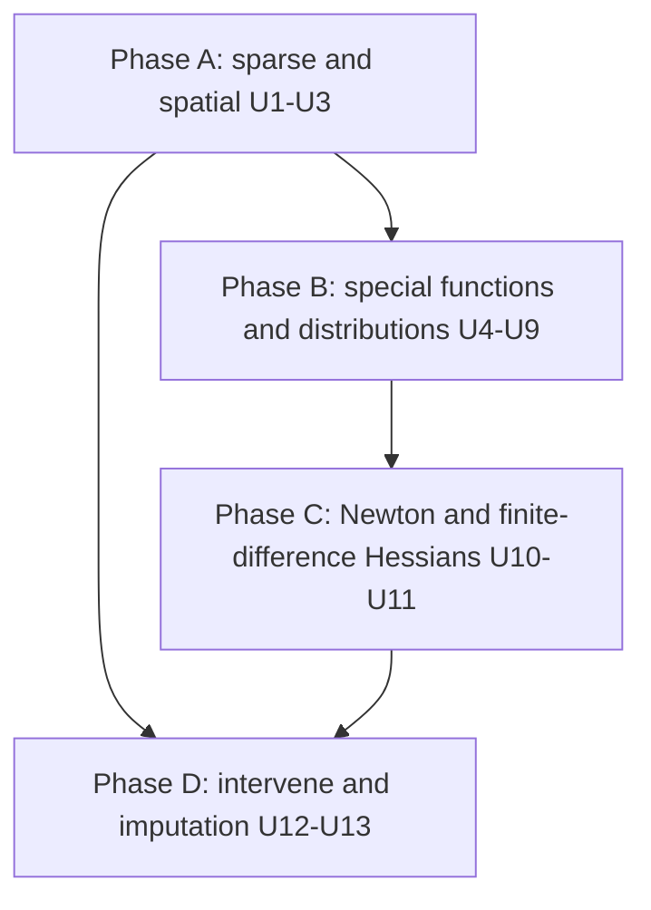

# Keanu Spatial Models, Distribution Tail, Newton and Causal Tools - Plan

## Goal Capsule

- **Objective:** close four remaining gaps with Stan and PyMC from the 2026-11-06 gap review:
  - (A) sparse matrices and spatial models (ICAR, proper CAR, BYM2);
  - (B) the long tail of distributions and special functions, including the Wiener first-passage time and GEV;
  - (C) a Newton trust-region optimizer, plus finite-difference Hessians so the Laplace approximation works on ODE, lambda and custom-distribution models;
  - (D) a do-operator for interventions, and automatic imputation of missing observations.
- **Out:** Python bindings (the user deferred them on 2026-11-06).
- **Authority:** this plan's Product Contract, then its Key Technical Decisions, then repo conventions (`CONTRIBUTING.md`, `docs/decisions/`). Java compatibility is not a constraint.
- **Execution profile:**
  - Phased; each unit leaves `main` green.
  - Work on `main` of the fork (`fork` remote) and run the Verification Contract before every commit.
  - Push after each unit. Never `cargo publish`, never push to `origin`.
- **Stop conditions:** stop and ask if a unit needs a new dependency that isn't MIT/Apache/BSD compatible or that adds native code, or if a design here changes public behaviour of existing features in a way not described below.
- **Tail ownership:** each unit updates its rustdoc, book chapter and `CHANGELOG.md` (new subsection "Spatial models, distributions, Newton and causal tools").

---

## Product Contract

### Summary

This plan adds four things:
- a sparse matrix type with a sparse matrix–dense product op, and ICAR, proper CAR and BYM2 spatial random effects, with a disease-mapping example;
- about twenty new distributions and the special functions they need: Bessel K and general-order Bessel I, Lambert W, the Gauss hypergeometric function and Owen's T. This includes the Wiener drift-diffusion density with a cognitive-science example, extreme-value distributions, and mixtures of different families;
- a trust-region Newton optimizer using exact Hessian-vector products, and a finite-difference Hessian fallback;
- `intervene` (do-operator) and masked observations that impute missing values automatically, with examples.

### Problem Frame

Keanu now serves continuous, mixed-discrete, ODE, state-space and simulator models. Four kinds of real-world model are still blocked:
- **Areal spatial models** need sparse neighbourhood structure and ICAR/BYM2 priors.
- **Many applied likelihoods** are missing: drift-diffusion for response times, GEV and generalised Pareto for extremes, skewed and heavy-tailed families, Wishart and multivariate Student-t, Plackett–Luce rankings, mixtures of different families for cure models.
- **The Laplace approximation fails on ODE models**, and there is no second-order optimizer.
- **Causal what-if questions and data with missing values** need hand-rewritten models.

### Requirements

**Sparse matrices and spatial models**
- R1. A CSR sparse matrix type in keanu-tensor, and a graph op multiplying a constant sparse matrix by a dense vector or matrix, with first- and second-order derivatives and save/load.
- R2. An ICAR distribution (pairwise-difference form, with a sum-to-zero constraint per connected component), a proper CAR distribution with an exact, cheap log-determinant, and a BYM2 builder with the standard scaling factor.
- R3. A disease-mapping example with BYM2 on areal count data.

**Distributions and special functions**
- R4. Special functions: modified Bessel K_ν and log I_ν for real ν ≥ 0 (with x-derivatives), Lambert W₀ and W₋₁, the Gauss hypergeometric function ₂F₁ (and its parameter derivatives where the CLV likelihoods need them), and Owen's T. Plus a general-ν Matérn kernel.
- R5. Continuous distributions: SkewNormal, ExGaussian, Gumbel, GeneralizedExtremeValue, GeneralizedPareto, InverseGaussian, Kumaraswamy, LogitNormal, HalfStudentT, AsymmetricLaplace, LogLogistic, Rice and GeneralizedGamma.
- R6. Discrete and multivariate distributions:
  - discrete: DirichletMultinomial, HyperGeometric, OrderedProbit, Skellam and PlackettLuce;
  - multivariate: MvStudentT, Wishart, InverseWishart (with Cholesky-parameterised forms and a covariance-matrix support and transform), MatrixNormal and VonMisesFisher (with a unit-vector support).
- R7. A Wiener first-passage-time distribution with 4 parameters (boundary separation, drift, non-decision time, starting point) plus optional across-trial drift variability, with gradients, and a drift-diffusion example.
- R8. Mixtures of different families, and a user-facing transformed distribution (any built-in bijector applied to a base distribution, with the log-Jacobian).
- R9. Every new distribution has a support, sampler, log density, gradients and CDF/log-CDF where a closed form or special function exists. Each has second-order rules unless the unit names an exception. Each works with the existing machinery where applicable: mixtures, log-density op, pointwise log-likelihood, Gibbs/marginalisation for finite supports, and save/load.

**Second-order optimisation and Laplace**
- R10. A trust-region Newton optimizer (Steihaug–Toint conjugate gradient on exact Hessian-vector products) for MAP and maximum likelihood.
- R11. A finite-difference Hessian-vector product fallback (central differences of exact gradients). Laplace and the Newton optimizer can use it, by explicit choice or automatically when a node has no second-order rule. With it, the Laplace approximation works on ODE models.

**Causal and missing data**
- R12. `intervene(graph, state, &[(node, value)])` returns a graph in which each intervened node is a constant (its log-probability term and incoming dependence removed), with an id mapping. It supports interventional and counterfactual-style posterior predictive queries, shown by an example.
- R13. Observing an element-wise node with a mask of missing elements turns the missing elements into latents automatically and imputes them. This works for observations and covariates, and draws of the imputed values are available; shown by an example.

### Acceptance Examples

- AE1. ICAR on a 10×10 lattice:
  - its log density equals −½ φᵀQφ for the graph Laplacian Q;
  - NUTS draws sum to zero within each connected component;
  - the BYM2 scaling factor matches the geometric mean of the diagonal of Q's generalised inverse to 1e-10.
- AE2. Proper CAR on a 50-node random graph has log density equal to the dense multivariate normal with precision τ(D − αW) to 1e-10.
- AE3. Wiener density:
  - integrates to the probability of hitting each boundary (closed form) within 1e-6;
  - matches published reference values (Navarro and Fuss 2009) to 1e-8;
  - gradients match finite differences.
- AE4. GEV with ξ → 0 matches Gumbel to 1e-8, and its log CDF matches the closed form.
- AE5. The Laplace approximation on the SIR example's posterior (finite-difference Hessian) gives means and standard deviations within 20% of NUTS's.
- AE6. Trust-region Newton reaches the MAP of the radon model in fewer gradient evaluations than L-BFGS, to the same optimum.
- AE7. On a simulated confounded model X ← Z → Y, X → Y:
  - the posterior predictive of Y under `intervene(X = x)` has the mean of the true interventional distribution;
  - conditioning on X = x gives the confounded mean instead.
- AE8. A Gaussian regression with 20% of outcomes and 10% of one covariate missing at random recovers the coefficients within their 90% intervals, and the imputed outcomes' posterior means correlate above 0.9 with the held-out truth.

### Scope Boundaries

- Python/R bindings are out (deferred by the user).
- Sorting, FFT, convolution, QR and SVD ops are out.
- Sparse matrices with latent values (differentiable sparse entries), sparse Cholesky and sparse precision MVNs beyond CAR/ICAR are out.
- The 7-parameter Wiener (starting-point and non-decision-time variability) is out; drift variability is in.
- Imputation of multivariate nodes (missing components of an MVN) is out; whole missing vectors are allowed only if trivially element-wise.
- Counterfactual inference with abduction (structural causal models with fixed exogenous noise) is limited to what posterior predictive on an intervened graph gives.
- Publishing to crates.io is out.

---

## Planning Contract

### Key Technical Decisions

- **KTD1. Sparse matrices are constants.**
  - `keanu_tensor::SparseMatrix` is CSR with f64 values, built from triplets or a dense tensor, with `matvec`, `matmat`, the transpose product and `to_dense`.
  - `Op::SparseMatMul(Arc<SparseMatrix>)` has one dense parent (vector [n] or matrix [n, k]). Its JVP is A·ẋ, its VJP Aᵀ·ḡ, and its second-order rule is zero (it is linear).
  - Saved as triplets in the schema.
- **KTD2. ICAR follows Morris et al. (2019, Stan case study).**
  - Log density −½ Σ_{i~j} (φᵢ − φⱼ)², from an edge list.
  - The sum-to-zero constraint is hard: a new `Support::SumToZeroComponents` reuses the U16 isometric transform per connected component.
  - Singletons get a standard normal (the usual convention, documented).
  - Its scale is a parameter σ (density of φ/σ with −(n − components)·log σ).
- **KTD3. Proper CAR uses the sparse eigenvalue trick (Jin, Carlin and Banerjee 2005; Joseph's Stan case study).**
  - Precision τ(D − αW).
  - The log-determinant is Σ log(1 − αλᵢ) + Σ log Dᵢᵢ + n log τ, with λ the eigenvalues of D^{-1/2}WD^{-1/2}, computed once at build time with `eigh`.
  - The quadratic form uses the sparse product.
- **KTD4. BYM2 follows Riebler et al. (2016).**
  - b = σ(√(ρ/s)·φ + √(1−ρ)·θ), with φ ICAR, θ ~ N(0, 1) and ρ ∈ (0, 1).
  - s is the geometric mean of the diagonal of the generalised inverse of the ICAR precision, per connected component (INLA's `scale.model`), computed densely at build time (documented O(n³), fine to a few thousand areas).
- **KTD5. Special functions in-house from published algorithms**, as before (no new dependency):
  - Bessel K_ν and I_ν: Temme's method for small x and continued fractions/uniform asymptotics for large x (Numerical Recipes' algorithm descriptions, not its code; or Amos-style formulas).
  - Lambert W: Halley iteration from Fritsch–Shafer–Crowley starting points.
  - ₂F₁: series with transformations to |z| < 0.5 (Abramowitz and Stegun 15.3) for the parameter ranges the distributions need.
  - Owen's T: Patefield and Tandy (2000).
  - Reference values are generated offline at high precision and committed as fixtures.
- **KTD6. Wiener follows Navarro and Fuss (2009) with Gondan, Blurton and Kesselmeier (2014) term bounds**, small-time and large-time series chosen per point.
  - Drift variability sv is integrated in closed form (Blurton et al. 2017).
  - Gradients use the derivative series of Henrich et al. (2023) as in Stan's `wiener_full`.
  - Second order uses dual numbers over the series if practical; otherwise `NoSecondOrderRule`, documented (U12's finite-difference fallback then covers Laplace).
  - The value is a response time with the boundary given as a separate integer/boolean observed parent: lower boundary 0, upper 1 (Stan uses a separate density per boundary).
- **KTD7. Covariance support and transform.** `Support::CovarianceMatrix` with Stan's Cholesky-factor transform (log-diagonal plus strictly lower part, Jacobian as in the Stan reference manual) serves Wishart and InverseWishart latents. Unit vectors use Stan's `unit_vector` approach: an unnormalised auxiliary with a N(0, I) term, documented as non-bijective.
- **KTD8. Heterogeneous mixtures are a nested kind** `MixtureOf(Vec<DistributionKind>)` with weights plus each component's parameters in order. Components must be element-wise with the same value type. `Transformed(kind, Bijector)` applies a built-in bijector's forward map to a base draw, with log density base(inverse(x)) + log|J of inverse|.
- **KTD9. Trust-region Newton** follows Nocedal and Wright (2006), Algorithm 4.1 with the Steihaug–Toint CG subproblem, in unconstrained space (no Jacobian for MAP).
  - Defaults: initial radius 1, maximum radius 1e3, η = 1e-4, gradient tolerance 1e-8, CG tolerance min(0.5, √‖g‖)·‖g‖.
  - Boundary handling matches the other optimizers.
- **KTD10. Finite-difference HVPs.**
  - `HessianMethod::{Exact, FiniteDifference, Auto}` on `Parameterisation::hvp`/`hessian`.
  - The finite difference is (∇f(z + hv) − ∇f(z − hv)) / 2h with h = cbrt(ε)·max(1, ‖z‖)/‖v‖ (Stan's Laplace uses finite differences of gradients).
  - `Auto` uses exact rules and falls back on `NoSecondOrderRule`.
  - Laplace defaults to `Auto`.
  - The Hessian is symmetrised.
- **KTD11. `intervene` is a graph rewrite like `marginalize`.**
  - Each intervened node becomes a constant of the given value, keeping its label. Its parents stay if used elsewhere, and are dropped if they only fed it (with the mapping).
  - It returns `(Graph, State, Intervened)`.
  - Interventions on observed nodes are allowed (the observation is replaced).
  - Interventions on deterministic nodes are allowed.
  - Posterior predictive on the intervened graph uses draws from the original model mapped through `Intervened`.
- **KTD12. Masked observations rewrite the node.**
  - `observe_masked(builder or graph, node, values, mask)` for element-wise kinds splits the node into two:
    - an observed node with parameters gathered at the observed indices;
    - a latent node with parameters gathered at the missing indices.
  - It adds a deterministic `ScatterAdd`/`Where` combination with the original shape and label that downstream nodes use.
  - Implemented as a graph rewrite returning an id mapping. The imputed latent is labelled `<label>_missing`.
  - Like PyMC's automatic imputation.

### Phase Map

Phases run in letter order.
- U3 needs U1–U2.
- U5–U9 need U4.
- U11 is used by U10's fallback and by AE5.
- U12 and U13 are independent of each other.

---

## Implementation Units

| U-ID | Title | Key files | Depends on |
|---|---|---|---|
| U1 | Sparse matrices and sparse product op | `keanu-tensor/src/sparse.rs`, `keanu-graph/src/op/`, `keanu-io` | none |
| U2 | ICAR, proper CAR and BYM2 | `keanu-distributions/src/spatial.rs`, `keanu-graph/src/{op/distribution.rs,spatial.rs,transform/}` | U1 |
| U3 | Disease-mapping example and book chapter | `keanu/examples/disease_mapping.rs`, `book/src/spatial-models.md` | U2 |
| U4 | Special functions and general Matérn | `keanu-tensor/src/special.rs`, `keanu-graph/src/gp/` | none |
| U5 | Continuous distributions | `keanu-distributions/src/continuous/` | U4 |
| U6 | Discrete and multivariate distributions | `keanu-distributions/src/{discrete,multivariate}.rs`, `keanu-graph/src/transform/` | U4 |
| U7 | Wiener first-passage time and DDM example | `keanu-distributions/src/wiener.rs`, `keanu/examples/drift_diffusion.rs` | U4 |
| U8 | Heterogeneous mixtures and transformed distributions | `keanu-graph/src/op/{mixture,wrappers}.rs` | U5 |
| U9 | Extreme values and cure-model examples | `keanu/examples/` | U5, U8 |
| U10 | Trust-region Newton | `keanu-algorithms/src/optimizer/newton.rs` | U11 |
| U11 | Finite-difference Hessians and Laplace on ODE models | `keanu-graph/src/parameterisation.rs`, `keanu-algorithms/src/laplace.rs` | none |
| U12 | `intervene` and a causal example | `keanu-graph/src/intervene.rs`, `keanu/examples/causal_effect.rs` | none |
| U13 | Masked observations and imputation example | `keanu-graph/src/impute.rs`, `keanu/examples/missing_data.rs` | none |

Execution order: U1, U2, U3, U4, U5, U6, U7, U8, U9, U11, U10, U12, U13, then a whole-change-set review.

### U1. Sparse matrices and sparse product op
- **Requirements:** R1.
- **Approach:** KTD1. Validation: sorted unique column indices per row, finite values, shape checks. `DoubleVar::sparse_matmul`.
- **Tests:**
  - products match dense matmul for random sparse matrices (vector and matrix right-hand sides);
  - JVP/VJP/HVP against finite differences;
  - save/load round trip;
  - malformed triplets are rejected;
  - empty rows and an all-zero matrix work.

### U2. ICAR, proper CAR and BYM2
- **Requirements:** R2.
- **Approach:**
  - KTD2–KTD4.
  - Builder API takes an edge list or a symmetric 0/1 adjacency.
  - The connected components are computed once.
  - New supports and transforms, second-order rules, samplers: ICAR by sampling the intrinsic GMRF via eigendecomposition per component (documented O(n³)), proper CAR by dense Cholesky of the precision.
  - Save/load.
- **Tests:**
  - AE1 and AE2;
  - multiple components and singletons;
  - gradient/HVP against finite differences;
  - sampler moments match the precision's generalised inverse;
  - NUTS on BYM2 with simulated data recovers ρ and σ roughly.
- **Implementation note:** the neighbourhood is `keanu_distributions::Adjacency` (edge list in either orientation with repeats merged, a symmetric 0/1 matrix, or `Adjacency::lattice`), carried by the kinds as `DistributionKind::Icar(Arc<Adjacency>)` and `Car(Arc<Adjacency>)` like the KDE's samples, and saved as an `Adjacency` message. Its eigendecompositions (the CAR eigenvalues, each component's Laplacian for ICAR sampling, the scaling factors) are computed on first use and cached; `GraphBuilder::car` computes the eigenvalues when the node is built, so an island is an error there. The ICAR's `−(n − components)·log σ` counts only components of two or more areas: each island has its own N(0, σ²) (so contributes −log σ) and is not constrained, since a one-area sum-to-zero would pin it at 0; the support `Support::SumToZeroComponents` lists the constrained groups. The ICAR drops its normalising constant (AE1's −½ φᵀQφ), the CAR keeps it (AE2). σ, τ and α are scalar parameters, and the CAR has mean zero (add a mean node outside it). `bym2` returns the three nodes as `Bym2 { spatial, unstructured, effect }`. Tests: `keanu-distributions/tests/spatial.rs` (AE1's density and scaling factor, AE2 against the dense precision to 1e-10, components and islands, gradients, both samplers' covariances), `keanu-graph/tests/{spatial,transform,support,hessian}.rs` (nodes, the bijector, HVPs of both kinds), and `keanu-algorithms/tests/spatial.rs` (AE1's NUTS constraint on a 10 × 10 lattice plus a path and an island; BYM2 on a 12 × 12 lattice with two Gaussian observations per area recovering σ and ρ in their 90% intervals, about 15 s).

### U3. Disease-mapping example and book chapter
- **Requirements:** R3.
- **Approach:**
  - BYM2 Poisson model with expected counts and a covariate.
  - Use simulated counts on a planar lattice of about 100 areas with a known spatial field. A real public dataset may be used if its adjacency and counts can be embedded with clear provenance.
  - New book chapter `spatial-models.md`.
- **Tests:** recovers simulated ρ, σ and the covariate effect within 90% intervals; R-hat < 1.01; modest runtime.
- **Implementation note:** the example uses ρ ~ Beta(1, 1) rather than the Beta(0.5, 0.5) of Morris et al.: with Beta(0.5, 0.5) and these data (whose posterior has mass near ρ = 1) every NUTS chain was stuck at ρ = 1.0 exactly (every parameter constant, R-hat infinite) after warm-up, a point where the logistic transform has rounded to its bound and the beta density is infinite. It was not diagnosed further; it is recorded here for the whole-change-set review rather than fixed in this unit. The covariate is i.i.d. normal: an east-west trend was confounded with the spatial effect (β₁'s interval missed the truth). The test uses data seed 6 (with 1,000 draws, seeds 1, 2, 4, 5 and 6 covered every truth and seed 3 missed β₀ by 0.01; R-hat for ρ needed 2,000 draws per chain to stay below 1.01), 4 chains of 2,000 draws after 2,000 warm-up steps, about 35 s. Two guide samples (`spatial_models`, `bym2` in `keanu/tests/book.rs`) show the neighbourhood, a sparse neighbour sum, ICAR draws and a small BYM2 fit by NUTS.

### U4. Special functions and general Matérn
- **Requirements:** R4.
- **Approach:**
  - KTD5, with elementwise graph ops where useful (`bessel_k`, `log_bessel_i`, `lambert_w0`).
  - `gp::Kernel::matern(nu, …)` for constant ν > 0 using K_ν (the existing half-integer kernels stay).
- **Tests:**
  - fixtures at high precision, with relative tolerances by region;
  - x-derivatives against finite differences;
  - recurrences;
  - the general Matérn at ν = 1.5 and 2.5 equals the closed forms.
- **Implementation note:** the functions are in `keanu-tensor/src/special/{bessel,lambert,hypergeometric,owens_t}.rs`.
  - Bessel: K_ν (any real ν) and I_ν (ν >= 0) are computed in logs (with scaled forms and the ratios
    K_{ν+1}/K_ν and I_{ν+1}/I_ν, from which the x-derivatives follow), by Temme/Steed plus the forward recurrence
    for K, and the power series, the Hankel expansion or the Wronskian with the I-ratio continued fraction for I;
    for ν >= 30 by Debye's uniform expansions (fourteen terms, coefficients generated exactly offline). ν is a
    constant everywhere: Skellam and von Mises–Fisher need no ν-derivatives (ν is the data or the dimension). I_ν
    of a negative argument is NaN.
  - ₂F₁: rather than A&S 15.3's transformations about z = 1, whose integer c − a − b cases need separate limiting
    forms, z in (½, 1) is reached by continuing the solution from z = ½ with Taylor series of the hypergeometric
    equation (each step half way to 1), and z < 0 by Pfaff's transformation; polynomial cases (and polynomial
    Euler transforms) are summed directly. The whole algorithm runs over the existing dual numbers, so
    `hyp2f1_derivatives` gives exact first and second derivatives in a, b, c and z (no finite differences). No
    unit of this plan consumes ₂F₁ (the CLV likelihoods are not planned here), so there is no graph op for it.
    Accuracy: 1e-14 on z in [−1, 0.999), 5e-14 elsewhere for the fixture's parameters (|a|, |b| <= 25,
    0 < c <= 26); second derivatives lose accuracy as z nears 1 (1e-9 at 1 − z = 1e-6, 1e-5 at 1e-10), because
    the equation determines F'' through a cancellation there.
  - Owen's T: Patefield and Tandy's reductions (symmetry and the a > 1 identity with complementary normal CDFs),
    then one 32-point Gauss–Legendre rule for the reduced integral (in x for h <= 1, in y = hx truncated at 9.5
    otherwise) instead of their six-method table; it is within 2e-14 of mpmath everywhere tested.
  - Graph ops: `UnaryOp::{LambertW0, LambertWm1}`, `BinaryOp::OwensT`, and `Op::Bessel { kind, order }` with
    `BesselOp::{K, LogK, LogI, Matern}` (ν is part of the op, not a parent, so it cannot be given a gradient by
    mistake; an order out of range is a build error). The Matérn correlation is an op of its own so that
    x^ν K_ν(x) is formed in logs and its derivatives, −x^ν K_{ν−1} and f + (2ν − 1) f'/x, avoid the unstable
    downward recurrence. `Kernel::matern` works with `Hsgp` for any ν (the spectral density was already general).
  - Fixtures: `keanu-tensor/tests/fixtures/special_extra.{py,json}` (mpmath, 50 digits, about 8,400 cases).

### U5. Continuous distributions
- **Requirements:** R5, R9.
- **Approach:**
  - One family at a time through the `distributions!` macro.
  - Parameterisations follow Stan's functions reference where one exists, otherwise PyMC; this is documented per family.
  - GEV/GeneralizedPareto supports depend on parameters, like Uniform's.
- **Tests (each family):**
  - density normalises (quadrature);
  - CDF matches the integrated density;
  - gradients and HVPs against finite differences;
  - sampler moments and the KS statistic;
  - support edges are impossible.
- **Also:** AE4.
- **Implementation note:** each family's element-wise log density (and log CDF and log survival function) is one
  generic formula over second-order forward-mode dual numbers (`keanu-distributions/src/jet.rs`, a `Jet<K>` like
  keanu-tensor's private one plus the special functions the families need: ln Φ, Owen's T, ln I₀, the log
  incomplete beta and gamma functions with their shape derivatives), so the gradient, the graph's density and CDF
  second-order rules and the value all come from it (`log_prob_derivatives`, `log_cdf_derivatives`, the public
  `ElementDerivatives`) instead of hand-derived rules. The families are in `continuous/{skewed,extreme,
  unit_interval,lifetime}.rs`, generated by a `derived_distribution!` macro. Parameterisations: Stan's for the skew
  normal, ex-Gaussian (`exp_mod_normal`), Gumbel, log-logistic and the asymmetric Laplace, which is Stan's
  `skew_double_exponential(μ, σ, τ)` (μ the τ-quantile) rather than PyMC's (b, κ, μ) (the mapping is documented);
  PyMC's for the GEV (`GenExtreme`, ξ > 0 heavy-tailed), inverse Gaussian (`Wald(μ, λ)`), Kumaraswamy,
  logit-normal, half Student-t (real ν) and Rice; neither has the generalized Pareto, which takes the usual
  (μ, σ, ξ) form, nor the generalized gamma, which is Stacy's family as (θ, k, p) with Stacy's d = kp (SciPy's
  `gengamma`), so p = 1 is the existing gamma(θ, k). Deviations: the Rice has no CDF (it needs Marcum's Q
  function), so it can't be truncated or censored; the skew normal's CDF is Φ(z) − 2T(z, α) as in Stan, not in
  logs, so it underflows in the far tails and loses relative precision on its short side (documented; the tail test
  excludes it); the ex-Gaussian's CDF is a difference in its far left tail. The GEV and generalized Pareto supports
  are reported as `Real`, `GreaterThan`, `LessThan` or an element-wise `Interval` with infinite ends, depending on
  the signs of ξ. Truncation inverts the CDF for the Gumbel, GEV, generalized Pareto, Kumaraswamy, logit-normal,
  asymmetric Laplace and log-logistic and uses rejection for the rest. The hurdle's list of positive continuous
  inner kinds was not extended. Tests: `keanu-distributions/tests/continuous_families.rs` (normalisation and CDFs
  by tanh-sinh quadrature, inverse CDFs, gradients and Hessians against finite differences, moments and a KS test
  on 20,000 draws, support edges, tails, AE4 to 1e-8 for ξ within 1e-10 of 0 with the derivatives in ξ continuous,
  and the GEV log CDF against its closed form), `keanu-graph/tests/continuous_families.rs` (element-wise terms, the
  log-density op, mixtures, truncated and censored sampling and renormalisation, gradients through the graph),
  `keanu-graph/tests/{hessian,support}.rs` (every kind, and truncated and censored forms of every kind with a CDF)
  and keanu-io's round trip.

### U6. Discrete and multivariate distributions
- **Requirements:** R6, R9.
- **Approach:**
  - KTD7.
  - Wishart/InverseWishart in both covariance and Cholesky forms.
  - PlackettLuce over a permutation value (i64 [K]) with worths.
  - Skellam via log I_ν.
  - Finite supports for HyperGeometric/DirichletMultinomial where enumerable (Gibbs and marginalisation).
- **Tests:**
  - pmfs sum to 1;
  - multivariate densities against dense formulas;
  - the covariance transform round-trips with the right Jacobian (finite-difference log-det);
  - NUTS on a Wishart latent recovers a known covariance;
  - von Mises–Fisher sampling (Wood 1994) moments.

### U7. Wiener first-passage time and DDM example
- **Requirements:** R7.
- **Approach:**
  - KTD6, with a simulator for draws (random-walk discretisation is not acceptable; use the exact rejection algorithm of Tuerlinckx et al. 2001 or Drugowitsch 2016).
  - Example: hierarchical DDM on simulated response times for a few subjects and two conditions.
- **Tests:** AE3; sampler matches the density (KS) and the boundary probabilities; NUTS recovers simulated parameters.

### U8. Heterogeneous mixtures and transformed distributions
- **Requirements:** R8, R9.
- **Approach:** KTD8; works with pointwise log-likelihood and the log-density op.
- **Tests:**
  - a mixture of a Gamma and a LogNormal against hand-written logsumexp, with gradients and HVPs;
  - `Transformed(Gaussian, LowerBound(0))` equals a LogNormal shifted appropriately;
  - save/load.

### U9. Extreme values and cure-model examples
- **Requirements:** R5, R8.
- **Approach:**
  - Example 1: GEV for annual maxima with return levels (simulated, or a small public-domain series with provenance).
  - Example 2: a mixture cure survival model (cured fraction plus censored Weibull/LogLogistic) using heterogeneous mixtures with censoring.
- **Tests:** recover simulated parameters within 90% intervals; return-level intervals cover the truth.

### U10. Trust-region Newton
- **Requirements:** R10.
- **Approach:** KTD9; `Newton` (or `TrustRegion`) alongside L-BFGS in `GradientOptimizer`, using `HessianMethod::Auto` from U11.
- **Tests:**
  - AE6;
  - the Rosenbrock function converges;
  - an indefinite-start case exits the trust region correctly;
  - boundary modes are reported like the other optimizers;
  - an ODE model works through the finite-difference fallback.

### U11. Finite-difference Hessians and Laplace on ODE models
- **Requirements:** R11.
- **Approach:** KTD10; Laplace gains `with_hessian_method`; book and docs updated (remove "Laplace doesn't support ODE models").
- **Tests:**
  - finite-difference HVP matches exact HVPs to 1e-6 relative on existing models;
  - `Auto` falls back only on `NoSecondOrderRule`;
  - AE5 on the SIR example;
  - lambdas and custom distributions now work with Laplace.

### U12. `intervene` and a causal example
- **Requirements:** R12.
- **Approach:**
  - KTD11.
  - Example `causal_effect.rs`: a confounded system fitted on observational data. It contrasts conditioning with intervening, and estimates the average treatment effect by posterior predictive under do(X = 1) minus do(X = 0).
  - Book section in `building-models.md` or a new chapter `causal-inference.md` (decide).
- **Tests:**
  - AE7;
  - interventions on deterministic and observed nodes;
  - labels and id mapping;
  - intervening on a node with descendants that are latents keeps their dependence;
  - error on unknown nodes or wrong shapes.

### U13. Masked observations and imputation example
- **Requirements:** R13.
- **Approach:**
  - KTD12; works for observed outcomes and for covariates modelled with a distribution.
  - The default sampler handles the new latents (NUTS for continuous, Gibbs for discrete).
  - Example `missing_data.rs`, with a book section.
- **Tests:**
  - AE8;
  - with no missing elements the log probability is unchanged;
  - with all missing the node is a pure latent;
  - discrete missing values via Gibbs;
  - a non-element-wise kind is rejected;
  - pointwise log-likelihood covers only observed elements.

---

## Risks

| Risk | Mitigation |
|---|---|
| Special-function accuracy across parameter ranges (Bessel, ₂F₁) | High-precision fixtures by region; document supported ranges and return NaN outside them rather than wrong values |
| Wiener series derivatives are intricate | Follow Henrich et al. (2023) term by term; finite-difference tests across small- and large-time regimes |
| ICAR's improper density with NUTS | Hard per-component sum-to-zero transform (KTD2) and tests on the constraint |
| Graph rewrites (`intervene`, imputation) repeat marginalisation's fragility | Reuse marginalisation's cloning helpers and id mapping; equality tests against hand-written models |
| Test-suite time keeps growing | Seeds, modest draws, the `parallel` feature; slow statistical checks only in examples |

## Verification Contract

As in the previous plan: before every commit run the following.
- `cargo fmt --all --check`
- `cargo clippy --workspace --all-targets --all-features -- -D warnings`
- `cargo test --workspace --all-features` and `cargo test --workspace`
- `RUSTDOCFLAGS="-D warnings" cargo doc --workspace --no-deps --all-features`
- `mdbook build book` and `cargo test -p keanu --test book` (book changes)
- the generated-schema check (schema changes)
- `cargo hack --workspace --feature-powerset --no-dev-deps check` (keanu-io or feature changes)

Also run the MSRV check from `CONTRIBUTING.md` at each phase exit, and `cargo deny check` at the end.

## Definition of Done

- Every requirement R1–R13 is covered by a passing test named in its unit.
- Rustdoc, book chapters and `CHANGELOG.md` are updated per unit.
- A whole-change-set code review is run and its findings are fixed or recorded in `docs/residual-review-findings/`.
- Nothing is published.
